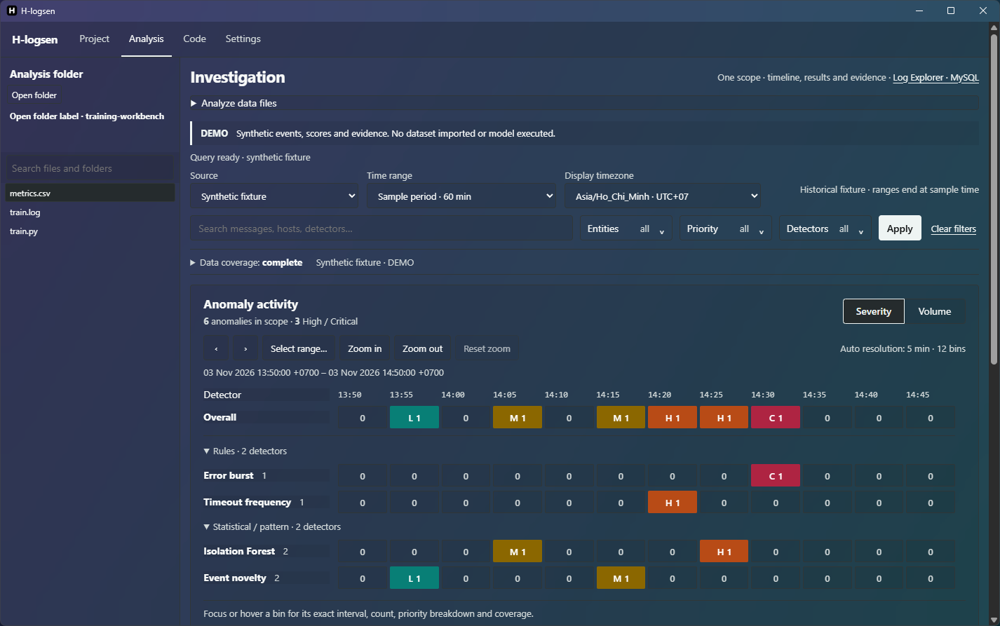

<div align="center">
  
  <h1>H-logsen</h1>
  <p><strong>A desktop workbench for investigating logs and machine learning runs.</strong></p>
  <p><a href="https://github.com/HieuHoai2704/H-LogSense/raw/refs/heads/download-v0.4.12/downloads/v0.4.12/H-logsen-0.4.12-Windows.zip"><strong>Download for Windows</strong></a> · <a href="https://github.com/HieuHoai2704/H-LogSense/raw/refs/heads/download-v0.4.12/downloads/v0.4.12/H-logsen-0.4.12-macOS.zip"><strong>Download for macOS</strong></a> · <a href="https://github.com/HieuHoai2704/H-LogSense/blob/download-v0.4.12/downloads/v0.4.12/SHA256.txt">SHA-256 checksums</a></p>
  <p>Desktop preview · v0.4.12</p>
</div>

H-logsen brings project files, raw logs, training metrics, and a local shell into one desktop workspace. Use it to inspect a run while it writes logs, compare runs, and read the source or supporting documents alongside the terminal.

## Desktop walkthrough

These screenshots were captured from the H-logsen 0.4.11 desktop window on Windows, including the native title bar and the live glass backdrop. The Black glass theme is shown at 82% frame transparency. A separate example project ran a Python training loop for 12 epochs and wrote the log and metrics shown here. English was selected and some controls still display Vietnamese labels. Local folder paths were hidden for the captures.

### Project

Open a project folder and select a log in the file tree. H-logsen tails the file and updates the activity view as lines arrive. Select an interval to inspect the matching lines in the read-only log panel. Use the adjacent chart to review loss by epoch or switch to machine load. Run history and comparison are available when the project has recorded runs.


### Analysis

Open an external dataset and inspect its schema, preview rows, and available summary statistics. Local profiling supports CSV, JSONL, and Parquet. The separate MySQL-backed investigation workflow requires a configured database and covers dataset ingestion, anomaly timelines, supporting evidence, and filtered CSV export.


<details>
<summary>See the anomaly timeline in Demo mode</summary>



The timeline screenshot uses the built-in synthetic fixture. The CSV screenshot above shows metrics from the local Python run.

</details>

### Code

Open a source file or PDF from the tree. Split the editor to view two files together, save with **Ctrl+S** or **⌘S**, and run a saved Python or JavaScript file with the corresponding runtime. Python diagnostics and formatting use tools installed in the selected project environment. The terminal uses the local operating system shell.


### Settings

Manage appearance, language, Python environments, and local capabilities here. Select a glass palette and use **Frame transparency** to adjust the interface from 0% to 100%. The operating system supplies the backdrop blur. To change the interface language, open **Settings → Language** and select a language from the list.


## Install the desktop preview

Download the ZIP for your operating system and extract it before running the installer. Use 64-bit Python 3.10–3.13. Python 3.12 is recommended. The installer creates a virtual environment inside the extracted directory and downloads Python dependencies.

| Platform | What you need | Verification for v0.4.12 |
| --- | --- | --- |
| Windows x64 | Python and Microsoft Edge WebView2 Runtime | Desktop startup and native glass verified. Regression checks covered the slider, selected cells, Project controls, and the Analysis surfaces. The screenshots above show the previous desktop build with the same interface. |
| macOS 14+ | Python, preferably from python.org | ZIP and SHA-256 verified. A launcher regression test covers the Cocoa startup arguments. Native macOS verification is pending. |
| Linux | Python for the source workflow | A desktop ZIP and clean native validation are pending. |

### Windows

Open Command Prompt in the extracted ZIP folder and run the two commands below. You can also double-click the scripts in File Explorer. The installer and launcher are in the same folder as the bundled wheel.

```bat
Install-H-logsen.cmd
Open-H-logsen.cmd
```

### macOS

Open Terminal in the extracted ZIP folder and run the installer, then the launcher.

```sh
sh Install-H-logsen.sh
sh Open-H-logsen.sh
```

Use the published [SHA-256 list](https://github.com/HieuHoai2704/H-LogSense/blob/download-v0.4.12/downloads/v0.4.12/SHA256.txt) to compare the downloaded ZIP. Run `Get-FileHash -Algorithm SHA256 .\H-logsen-0.4.12-Windows.zip` in PowerShell or `shasum -a 256 H-logsen-0.4.12-macOS.zip` on macOS.

## First project

1. Open **Project → Open folder** and choose the local project you want to inspect.
2. Select `train.log` in the tree to view its recent lines and log activity. For loss curves, place `metrics.csv` in the project with columns `epoch`, `train_loss`, and `val_loss`.
3. Select a log interval to inspect its lines. Switch to **Analysis** for file profiling or **Code** for editing and running a script.

## Architecture and scope

The desktop preview renders the Flask, Jinja, and JavaScript interface in an operating system web view. It uses WebView2 on Windows and WKWebView on macOS. The local Flask service listens on loopback. File access and terminal commands run under the signed-in OS account. Local file viewing, editing, terminal sessions, and profiling work without MySQL.

The MySQL-backed investigation pipeline is a separate workflow for imported log data. See the [original LogSense AI baseline](https://github.com/HieuHoai2704/H-LogSense/blob/675c718cdc0503fbcb9daf10fa7c76b3ffcf34dc/README.md) for its source setup and documentation.

## Source, downloads, and feedback

The `main` branch tracks the original LogSense AI investigation source and this showcase. The `download-v0.4.12` branch hosts the packaged desktop preview. Use the installer from the ZIP for the version shown above.

When filing an [issue](https://github.com/HieuHoai2704/H-LogSense/issues), include the app version, operating system, the workspace and action involved, and the smallest sample needed to reproduce the problem. Use sample logs or redact sensitive values before sharing.

A project-wide open-source license is pending. Desktop packages include third-party notices.
