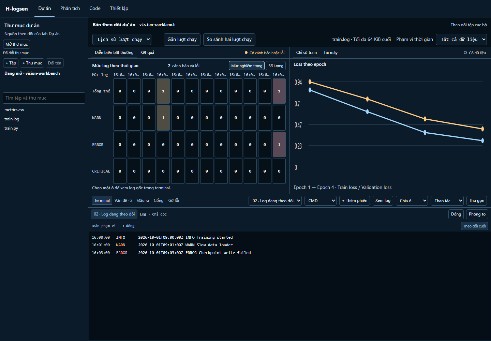
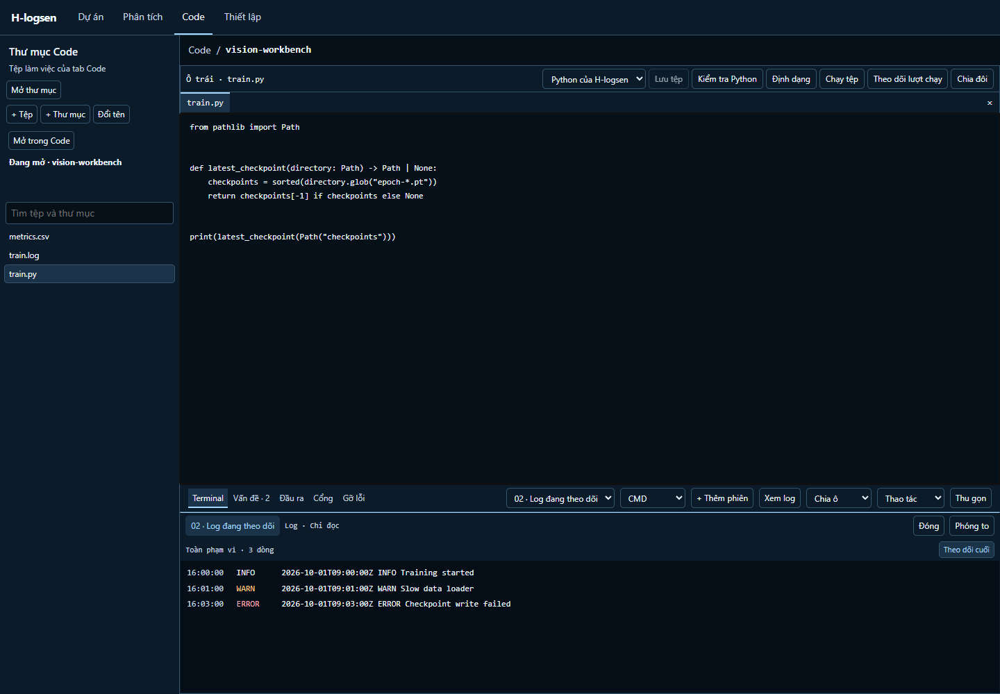

<div align="center">
  
  <h1>H-logsen</h1>
  <p><strong>A desktop workbench for logs, training runs, and local projects.</strong></p>
  <p><a href="https://github.com/HieuHoai2704/H-LogSense/raw/refs/heads/download-v0.4.8/downloads/v0.4.8/H-logsen-0.4.8-Windows.zip"><strong>Download for Windows</strong></a> · <a href="https://github.com/HieuHoai2704/H-LogSense/raw/refs/heads/download-v0.4.8/downloads/v0.4.8/H-logsen-0.4.8-macOS.zip"><strong>Download for macOS</strong></a> · <a href="https://github.com/HieuHoai2704/H-LogSense/blob/download-v0.4.8/downloads/v0.4.8/SHA256.txt">SHA-256</a></p>
  <p>Desktop preview · v0.4.8</p>
</div>



<sub>H-logsen on Windows with sample training metrics and logs. The local folder path is hidden in this capture.</sub>

## One workspace for the investigation

| Workspace | What you can do |
| --- | --- |
| **Project** | Open a local folder, follow a log, and inspect training metrics and machine activity. Select a time bin to see the underlying log lines. |
| **Analysis** | Profile external CSV, JSONL, and Parquet files. MySQL-backed log investigation requires a configured database. |
| **Code** | Edit files, open a PDF alongside code, and run saved Python or JavaScript files in the terminal. Python checks and formatting use tools installed in the project. |
| **Settings** | Choose an appearance and language, configure the Python environment, and manage local capabilities. |

<details>
<summary><strong>See the Code workspace</strong></summary>



</details>

## Get started

Use 64-bit Python 3.10–3.13. Python 3.12 is recommended. The installer creates a local virtual environment and downloads dependencies on first run.

**Windows x64**

1. Extract the Windows ZIP.
2. Run `Install-H-logsen.cmd`, then `Open-H-logsen.cmd`.
3. Open a project folder and choose a log in the file tree.

**macOS 14 or later**

Extract the macOS ZIP, open Terminal in the extracted directory, and run:

```sh
sh Install-H-logsen.sh
sh Open-H-logsen.sh
```

| Platform | Verification for v0.4.8 |
| --- | --- |
| **Windows** | Desktop startup verified. The workbench passed 24 browser tests and 34 Python tests on Windows. |
| **macOS** | ZIP built and checksum verified. Native installation and desktop operation await verification. |

## Architecture

H-logsen uses a local Flask service, Jinja templates and JavaScript. The desktop window uses WebView2 on Windows and WKWebView on macOS. Terminal sessions use the operating system shell. Opening files, editing code and profiling local data work without MySQL.

## Source and contributions

The default branch currently contains the original LogSense AI investigation baseline. The desktop packages above are a later preview. See the [original baseline README](https://github.com/HieuHoai2704/H-LogSense/blob/675c718cdc0503fbcb9daf10fa7c76b3ffcf34dc/README.md) for setup and design notes for the source currently tracked here.

Use [Issues](https://github.com/HieuHoai2704/H-LogSense/issues) to report a problem. Include the app version, operating system and steps to reproduce with sample data.

A project-wide open-source license has yet to be selected. The desktop packages include third-party notices.
