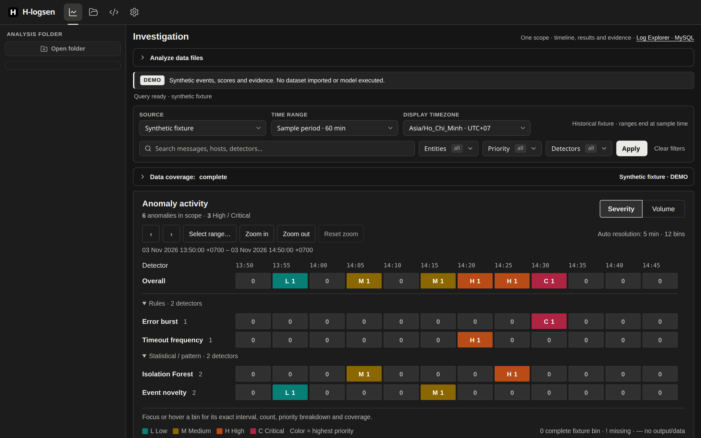
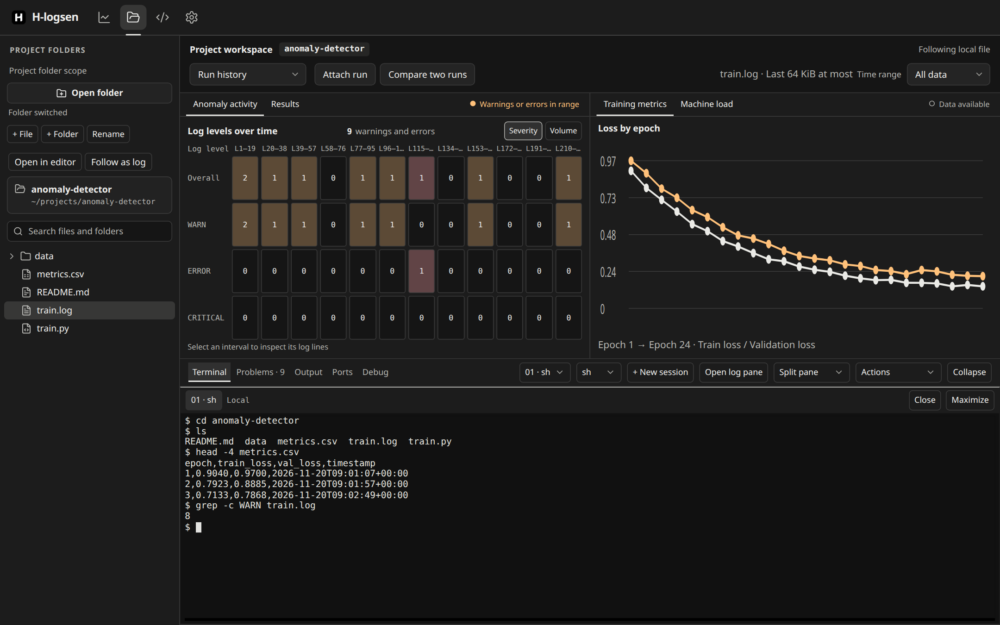
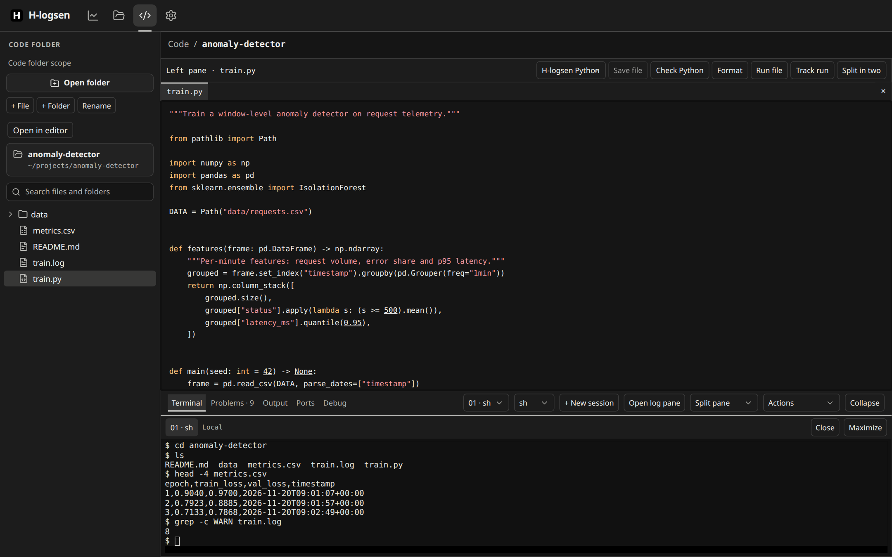
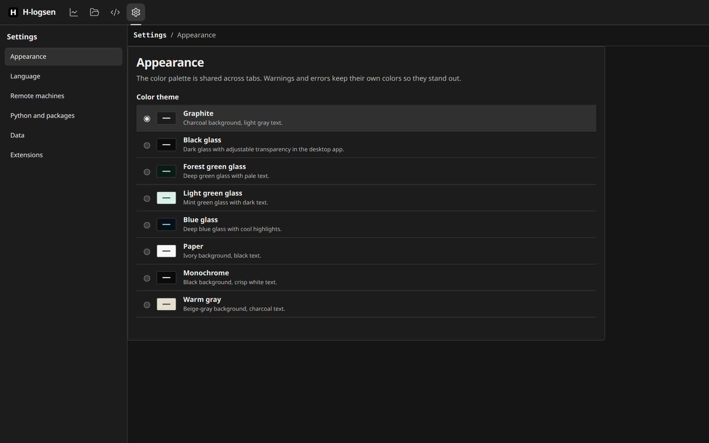
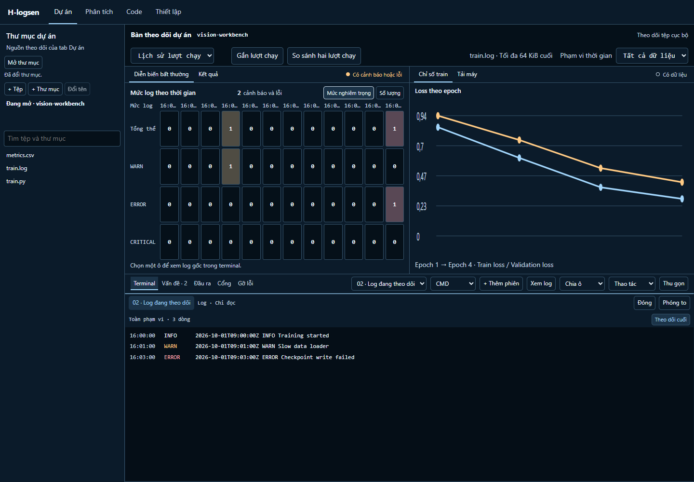
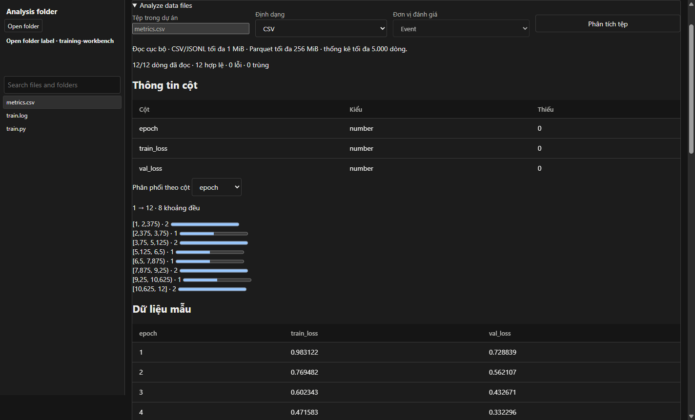
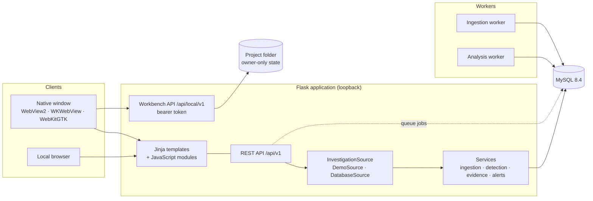
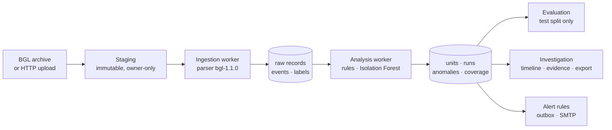

<div align="center">


# H-logsen

**A local workbench for log investigation, anomaly detection and machine-learning runs.**

One desktop application for reading a training run while it writes its logs, profiling the data behind it,
and investigating anomalies in large system logs with full provenance from every finding back to the raw line.


<p>
  <a href="https://github.com/HieuHoai2704/H-LogSense/releases/download/v0.4.13/H-logsen-0.4.13-Windows.zip"></a>
  <a href="https://github.com/HieuHoai2704/H-LogSense/releases/download/v0.4.13/H-logsen-0.4.13-macOS.zip"></a>
  <a href="https://github.com/HieuHoai2704/H-LogSense/releases/download/v0.4.13/H-logsen-0.4.13-Linux.zip"></a>
</p>

<sub>Version 0.4.13 · <a href="https://github.com/HieuHoai2704/H-LogSense/releases">All releases and checksums</a></sub>

[Overview](#overview) ·
[Screenshots](#screenshots) ·
[Architecture](#architecture) ·
[Getting started](#getting-started) ·
[Machine learning](#machine-learning-and-evaluation) ·
[Security](#security-model) ·
[Quality](#engineering-quality) ·
[Documentation](#documentation) ·
[Reviewing](REVIEWING.md)

</div>

<br>



---

## Overview

H-logsen combines two products that share one codebase, one interface and one design language:

| | Desktop workbench | Investigation platform |
| --- | --- | --- |
| **Purpose** | Work on a project while it runs: logs, training metrics, code and a shell in one window | Investigate anomalies in large system logs (Loghub BGL) with evidence and provenance |
| **Data** | Files in a project folder chosen by the user | MySQL 8.4: raw lines, parsed events, detection units, runs, anomalies, coverage |
| **Runs on** | A native window on Windows, macOS and Linux, or a local browser | The same application; ingestion and analysis run in separate workers |
| **Needs a database** | No | Yes (a synthetic demo source works without one) |

A few constraints shape every module:

- **Evidence before conclusions.** Every anomaly links back to the exact raw bytes, line number and source
  artifact it came from, the detector version and configuration that produced it, and the coverage that
  proves the interval was actually analysed. Missing coverage is never presented as "no anomalies".
- **Honest evaluation.** Detectors never read labels. Splits are chronological and disjoint; thresholds are
  chosen on validation data and frozen before the test period. Reported metrics come with their cohort.
- **Bounded by design.** Every query, page, upload, cursor, preview and parser input has an explicit limit,
  so the interface stays responsive on millions of events and cannot be turned against the server.
- **Local and private.** The workbench listens on loopback only, behind a per-launch token. Credentials,
  uploads and model files are stored owner-only and verified after they are written.

## Highlights

| Area | What it does |
| --- | --- |
| **Log investigation** | Severity and volume timelines per detector, brush and zoom, facet filters with live counts, keyset-paginated results and a scoped CSV export that streams exactly the rows in scope |
| **Evidence drawer** | Raw log page with redaction before pagination, parsed fields, detector evidence (features, threshold, score direction), related anomalies by host, service, time or window, with signed cursors |
| **Ingestion** | Streaming, versioned BGL parser; atomic batches that commit rows, counters and checkpoint together; safe resume after a crash; immutable staging for HTTP uploads |
| **Detection** | Event rules and Isolation Forest per event; host-window rule and Isolation Forest models with chronological train / validation / test splits; frozen, checksum-verified model bundles for inference |
| **Alerting** | Rules per dataset, idempotent alert decisions with cooldown, incident acknowledgement, assignment and an append-only audit trail; an SMTP outbox with claim, send and record phases |
| **Desktop workbench** | File explorer, live log tailing with level timelines, loss-by-epoch charts, run history and comparison, machine load, split code editor with Ruff and Pyright, PTY terminals, SSH, PDF and Parquet preview |
| **Platform** | Native window via WebView2, WKWebView or WebKitGTK; OS-specific code isolated behind one interface; installers for all three systems |
| **Interface** | 15 languages with CLDR plural rules, eight colour palettes including native glass on Windows, keyboard navigation, reduced-motion support |

## Screenshots

All screenshots show the current build. The project shown is a sample training run; local paths are
replaced with `~/projects/...`.

| Project workspace | Code |
| --- | --- |
|  |  |
| Follow `train.log` while it is written. Cells group WARN, ERROR and CRITICAL lines by interval; selecting one pins its lines in the terminal. The loss chart reads `metrics.csv`. | A split editor with syntax highlighting, Ruff and Pyright diagnostics and formatting; tracked runs record their environment, Git state and outputs. |
| **Evidence** | **Settings** |
|  |  |
| Every finding opens its raw line, parsed fields, detector evidence and related anomalies, with previous / next navigation inside the current scope. | Palettes, language, Python environments, remote machines over SSH and built-in capabilities. |

<details>
<summary><strong>Native window on Windows (glass backdrop)</strong></summary>
<br>

Captured from the native window on Windows with the Black glass palette at 82% frame transparency
(version 0.4.11, before the icon navigation was introduced).




</details>

## Architecture

H-logsen is a modular monolith: one Flask application with clearly separated layers, rendered either in
a native OS web view or in a browser. Long-running work never happens inside an HTTP request.



| Layer | Location | Responsibility |
| --- | --- | --- |
| Presentation | `app/templates`, `app/static` | Server-rendered pages and JavaScript modules; no build step |
| HTTP | `app/api`, `app/web_datasets.py` | Thin routes, validation at the boundary, translated errors |
| Source interface | `app/api/sources.py` | One protocol, two backends; routes never branch on the data source |
| Domain services | `app/services` | Ingestion, detection, evidence, alerts; independent of HTTP |
| Contracts | `app/contracts.py` | Typed shapes shared across layers: investigation scope, job configuration, identities |
| Persistence | `app/models.py`, `app/domain.py`, `migrations/` | SQLAlchemy 2 models; composite foreign keys scope every row to its dataset |
| Workbench | `app/workbench` | Files, terminals, runs, previews; OS code isolated in `app/workbench/platforms` |
| Workers | `scripts/run` | Shared supervision loop with database back-off and recovery of interrupted jobs |

### Data pipeline



- **Ingestion** reads bounded physical lines, keeps the exact source bytes and their offsets, and commits
  each batch together with its checkpoint. Re-running the same artifact resumes; a changed artifact is
  rejected. Each event records the parser version that produced it, and a dataset never mixes versions.
- **Detection** runs over a snapshot (`input_revision`, highest event id). If the dataset changes while a
  detector runs, nothing is published. Window models write their features to a cache whose digest is part
  of the run configuration, so a retried job scores exactly the same input.
- **Isolation by dataset** is enforced in SQL: child tables carry `(dataset_id, id)` composite foreign keys,
  so a row cannot reference an event, unit or run of another dataset even through a bug in application code.

### Key design decisions

| Decision | Reason |
| --- | --- |
| Modular monolith instead of services | One deployable for a local tool; boundaries are enforced by modules, typed contracts and tests |
| Server-rendered UI with plain JavaScript | No build pipeline to maintain; behaves identically in three OS web views and a browser |
| Keyset pagination with signed cursors | Stable pages under concurrent imports; cursors cannot be forged or reused across scopes |
| Content Security Policy with per-response nonces | The workbench API can reach the file system, so injected script must not run |
| Frozen model bundles verified by SHA-256 | Inference must never refit or recalibrate on the data it scores |
| Outbox for e-mail | Delivery happens outside the transaction; a crash between send and record is detectable |

## Getting started

### Requirements

| | Windows | macOS | Linux |
| --- | --- | --- | --- |
| System | Windows 10 or 11, x64 | macOS 14 or later (Apple silicon or Intel) | Ubuntu 24.04 or 26.04 x64 with a desktop session |
| Python | 3.10 – 3.13, 64-bit (3.12 recommended) | 3.10 – 3.13 from python.org | System Python (3.12 or 3.14) |
| Window | Microsoft Edge WebView2 Runtime | System WKWebView | WebKitGTK (`gir1.2-webkit2-4.1`) |
| Database | MySQL 8.4, only for the investigation platform | | |

### Install the desktop application

Download the package for your system from the [latest release](https://github.com/HieuHoai2704/H-LogSense/releases/latest).
Each ZIP contains an installer that creates a private virtual environment, installs the application and
registers a launcher.

| System | Download | Install | Open |
| --- | --- | --- | --- |
| Windows | [H-logsen-0.4.13-Windows.zip](https://github.com/HieuHoai2704/H-LogSense/releases/download/v0.4.13/H-logsen-0.4.13-Windows.zip) | `Install-H-logsen.cmd` | `Open-H-logsen.cmd` or the H-logsen shortcut |
| macOS | [H-logsen-0.4.13-macOS.zip](https://github.com/HieuHoai2704/H-LogSense/releases/download/v0.4.13/H-logsen-0.4.13-macOS.zip) | `sh Install-H-logsen.sh` (or `Install-H-logsen.command` in Finder) | `sh Open-H-logsen.sh` |
| Linux | [H-logsen-0.4.13-Linux.zip](https://github.com/HieuHoai2704/H-LogSense/releases/download/v0.4.13/H-logsen-0.4.13-Linux.zip) | `sh Install-H-logsen.sh` | **H-logsen** in the application menu, or `sh Open-H-logsen.sh` |

Verify a download against [H-logsen-0.4.13-SHA256.txt](https://github.com/HieuHoai2704/H-LogSense/releases/download/v0.4.13/H-logsen-0.4.13-SHA256.txt):
`Get-FileHash -Algorithm SHA256 H-logsen-0.4.13-Windows.zip` in PowerShell, or
`shasum -a 256 H-logsen-0.4.13-macOS.zip` on macOS and Linux. Add `--browser` to either launcher to use a
local browser instead of the native window. Platform details are in [packaging/](packaging/README.md).

Releases are built by CI: pushing a version tag packages the application, installs and opens it on Windows,
macOS and Ubuntu, and only then publishes the release. To build the same packages locally:

```bash
python -m scripts.release.package_workbench --output dist/release
```

### Run from source

```bash
git clone https://github.com/HieuHoai2704/H-LogSense.git
cd H-LogSense
python -m venv .venv && . .venv/bin/activate        # Windows: .venv\Scripts\activate
python -m pip install -e ".[dev]"
python -m scripts.run.workbench --browser             # the workbench, in a local browser
python -m flask --app app run --host 127.0.0.1        # or the web application alone (synthetic demo)
```

Then open **Project → Open folder**, choose a project and select its log. A loss chart appears when the
project contains `metrics.csv` with `epoch,train_loss,val_loss` columns. The complete reference is the
[workbench guide](docs/WORKBENCH_GUIDE.md).

### Run the investigation platform with MySQL

On Windows and macOS the repository manages a private MySQL ZIP runtime bound to `127.0.0.1`; on Linux,
point `DATABASE_URL` at any MySQL 8.4 server (for example a container).

```bash
python -m scripts.run.mysql_runtime start
python -m scripts.run.mysql_runtime exec --role migrate -- -m flask --app app db upgrade
python -m scripts.run.mysql_runtime exec --role app -- -m scripts.run.database register-bgl --key bgl-research-v1
python -m scripts.run.mysql_runtime exec --role app -- -m scripts.run.database ingest-bgl --dataset ID --archive data/raw/BGL.zip --limit 100000
python -m scripts.run.mysql_runtime exec --role app -- -m scripts.run.database create-user --username analyst --role admin --dataset ID
python -m scripts.run.mysql_runtime exec --role app -- -m scripts.run.worker
python -m scripts.run.mysql_runtime exec --role app -- -m flask --app app run --host 127.0.0.1
```

The runtime generates private credentials and passes them to child processes without printing them;
account creation prompts for the password. Open `/?source=db-ID` to investigate. Uploads, alerts and the
ingestion worker are covered in the [operations guide](docs/OPERATIONS.md).

## Machine learning and evaluation

The detectors are baselines with deliberately strict evaluation rather than tuned showcase numbers.
Loghub labels are used only to evaluate the test period; labels supplied with an upload are reported
separately and marked unverified.

| Model | Unit | Test cohort | Precision | Recall | F1 | Average precision | FPR |
| --- | --- | --- | ---: | ---: | ---: | ---: | ---: |
| Isolation Forest, July holdout (preregistered) | Host window, 5 min | 172,529 observed windows | 22.52% | 55.43% | 0.3203 | 0.2656 | 0.2037% |
| Isolation Forest V2 (frozen study) | Host window | 89,119 later windows | | 38.60% | 0.4202 | 0.1845 | |
| Host-window IF, default policy (historical) | Host window | 100K-line prefix | | 0% | | | |

- These are **different cohorts** and must not be read as a progression on one test set.
- The July model misses 82 positive windows and raises 351 false positives on its test. Its frozen
  inference profile only scores closed windows after its calibration cutoff and never retrains.
- Features are label-blind: event count, severity share, template diversity and dominance per host window,
  with templates derived by replacing numeric and hexadecimal tokens.

Details: [July holdout and model contract](docs/ml/IF_JULY_HOLDOUT.md) ·
[Isolation Forest audit](docs/ml/ISOLATION_FOREST_AUDIT.md) ·
[detector semantics](docs/database/DETECTORS.md).

## Security model

| Concern | Control |
| --- | --- |
| Local API exposure | Loopback only; a random bearer token per launch; Host and Origin checks on every request |
| Script injection | Content Security Policy with per-response nonces; autoescaped templates; secrets, tokens and e-mail addresses redacted from displayed logs |
| Authentication | Password hashing, session reset at sign-in, rate-limited login, CSRF protection on every state change |
| Authorization | Default deny; roles (viewer, analyst, manager, admin) plus explicit per-dataset grants, enforced in queries and by composite keys |
| File system | Project root sandbox (system, home, temporary and hidden roots refused); credential files never served; Windows 8.3 aliases and reserved device names refused |
| Data at rest | Owner-only files and folders, verified after creation; a strict mode for filesystems that ignore POSIX modes |
| Uploads | Size, encoding and control-character checks; immutable staging; no download route for originals |
| Database | Least-privilege accounts; `DELETE` granted only on the two tables that need it |

Please report vulnerabilities privately as described in [SECURITY.md](SECURITY.md).

## Engineering quality

| Practice | Implementation |
| --- | --- |
| Tests | 240+ unit and API tests without a database; 125 integration tests against MySQL 8.4; 26 browser end-to-end tests; a clean install of the packaged wheel with a native desktop smoke test |
| Compatibility | Test suite verified on Python 3.10, 3.13 and 3.14; type-checked for Linux, Windows and macOS; dependency resolution verified for Windows x64 and macOS arm64 and x86_64 |
| Static analysis | ruff (lint and format) and mypy with strictly typed core modules, enforced in CI and pre-commit |
| Refactoring safety | Large refactors are verified with equivalence harnesses: tens of thousands of generated inputs fingerprinted before and after, on fixtures and on a real MySQL pipeline |
| Internationalization | 15 languages; whole-message catalogs with placeholders checked against the source; CLDR plural forms; a test rejects concatenated fragments |
| Continuous integration | Lint and types, packaging, MySQL integration, and a clean-install matrix on Windows, macOS (Apple silicon and Intel) and Ubuntu |

```bash
ruff check . && ruff format --check . && mypy               # static analysis
python -B -m unittest discover -s tests                     # unit and API tests
python -m scripts.qa.verify_mysql                           # MySQL integration (MYSQL_ADMIN_URL, DATABASE_URL)
python -m scripts.qa.qa_workbench_browser                   # browser end-to-end tests (Playwright)
```

## Repository layout

```text
app/                 the product
├── api/             REST routes and the investigation source interface
├── services/        ingestion, detection, evidence, investigation, alerts
├── parsers/         streaming BGL and HDFS parsers
├── workbench/       local files, terminals, runs, previews
│   └── platforms/   Windows, macOS, Linux and shared POSIX integration
├── templates/       Jinja pages and partials
├── static/          JavaScript modules, styles, vendored libraries
└── locales/         interface catalogs (14 languages; English is the source)
migrations/          Alembic schema history (MySQL 8.4)
scripts/             run · qa · ml · bench · release commands
tests/               unit, API, browser and MySQL integration tests
packaging/           installers and launchers for each platform
docs/                architecture, database, ML, guides and release notes
academic/            research notes and experiments (not shipped)
```

A file-by-file map is in [docs/development/CODE_STRUCTURE_VI.md](docs/development/CODE_STRUCTURE_VI.md).

## Documentation

| Topic | Documents |
| --- | --- |
| Using the workbench | [Workbench guide](docs/WORKBENCH_GUIDE.md) · [Vietnamese user guide](docs/development/USER_GUIDE_VI.md) |
| Operating the platform | [Operations guide](docs/OPERATIONS.md) · [MySQL runbook](docs/database/MYSQL_RUNBOOK.md) |
| API | [REST API reference](docs/database/API.md) |
| Data model | [Schema](docs/database/SCHEMA.md) · [ERD](docs/database/ERD.md) · [BGL pipeline](docs/database/BGL_PIPELINE.md) · [Uploads](docs/database/UPLOADS.md) |
| Machine learning | [Detectors](docs/database/DETECTORS.md) · [July holdout](docs/ml/IF_JULY_HOLDOUT.md) · [Isolation Forest audit](docs/ml/ISOLATION_FOREST_AUDIT.md) |
| Architecture | [Architecture notes](docs/architecture/README.md) · [Code structure](docs/development/CODE_STRUCTURE_VI.md) |
| Testing | [Testing guide](docs/database/TESTING.md) · [Installation verification](docs/releases/PORTFOLIO_VERIFICATION.md) |
| Contributing | [Reviewing](REVIEWING.md) · [Contributing](CONTRIBUTING.md) · [Security](SECURITY.md) |

## Status and limitations

H-logsen is at version **0.4.13** and is developed as a preview.

- The native window was verified on Linux for this version and on Windows for 0.4.12. macOS is exercised
  by the CI install matrix; a manual check on a physical Mac is still pending.
- External SMTP delivery, production deployment behind TLS, screen-reader certification and detection over
  the complete BGL archive are outside the verified scope.
- Uploads accept BGL-compatible text and single-column `raw_line` CSV; the platform is not a generic log importer.
- The private July model bundle is not part of the repository; a clone reports that profile as unavailable.

Planned work is tracked in the [backlog](docs/releases/BACKLOG.md).

## Contributing and review

Reviews are welcome. [REVIEWING.md](REVIEWING.md) is a guided tour for reviewers: what to read first, how
to verify each claim in this README, and checklists for security, data correctness, ML evaluation and the
interface. [CONTRIBUTING.md](CONTRIBUTING.md) covers the development setup and the standards a change must meet.

## License

Copyright © 2026 Truong Hieu Hoai. All rights reserved.

The source is shared for review and evaluation. No license to use, copy, modify or distribute it is granted
unless the author agrees in writing. Third-party components keep their own licenses; see
[THIRD_PARTY_NOTICES.md](THIRD_PARTY_NOTICES.md) and `app/static/vendor/`.

## Acknowledgements

The BGL and HDFS datasets come from [Loghub](https://github.com/logpai/loghub)
(Zhu et al., *Loghub: A Large Collection of System Log Datasets for AI-driven Log Analytics*, ISSRE 2023);
see [data/raw/LOGHUB_LICENSE.txt](data/raw/LOGHUB_LICENSE.txt). The interface vendors xterm.js,
highlight.js, Lucide icons and Moment.js.
