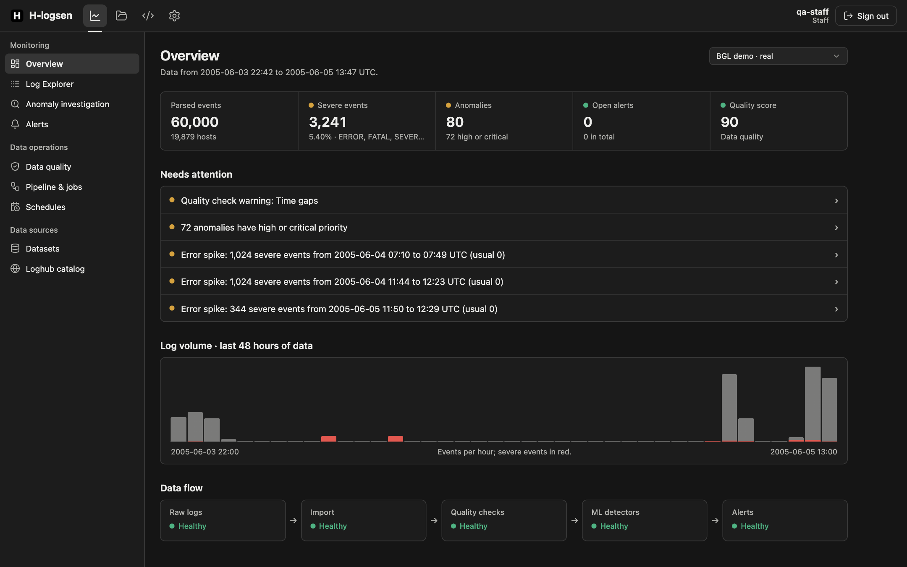
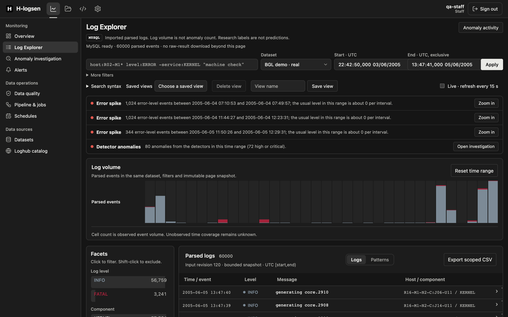
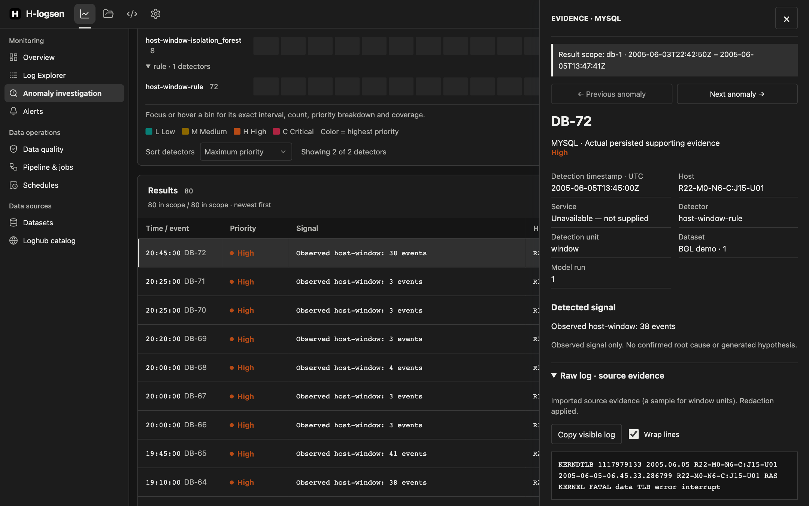
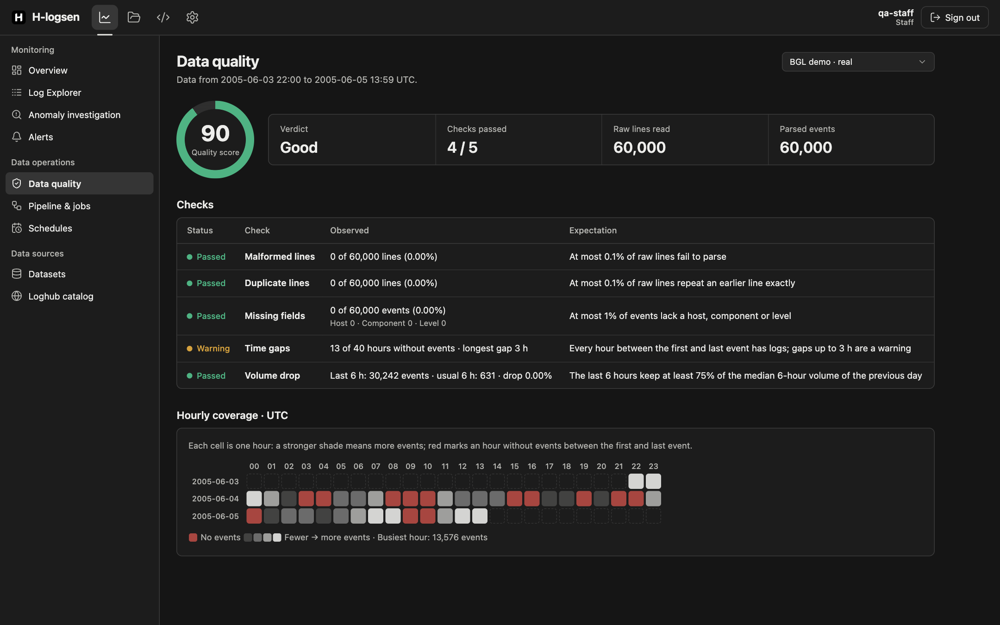
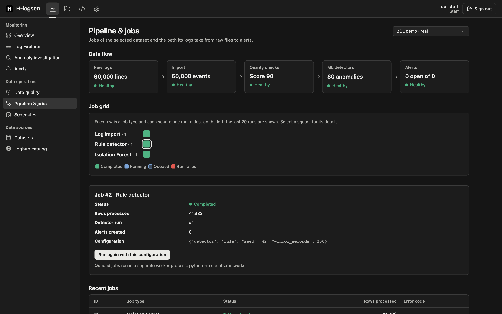
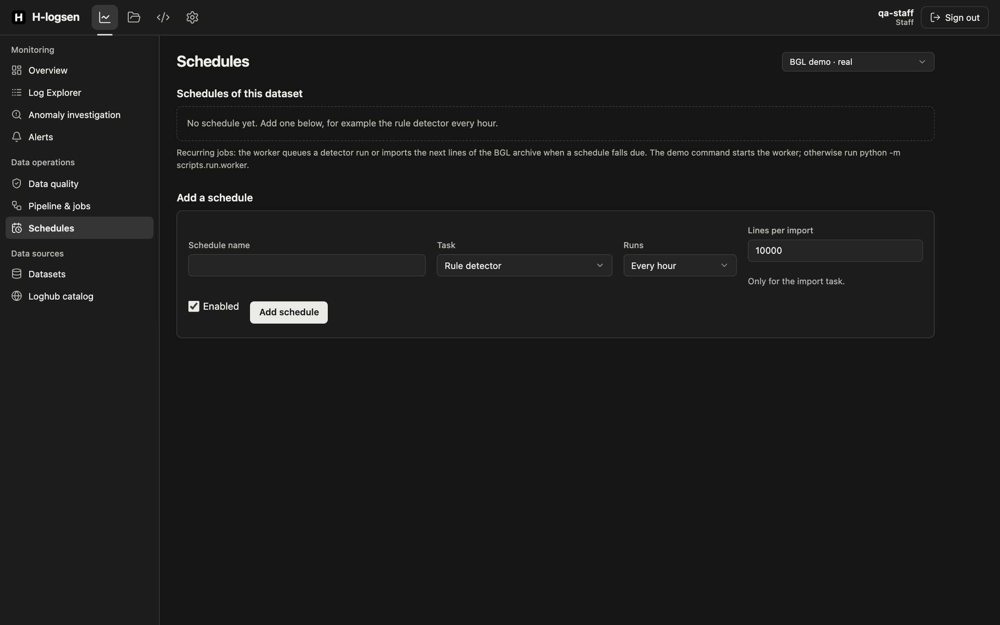
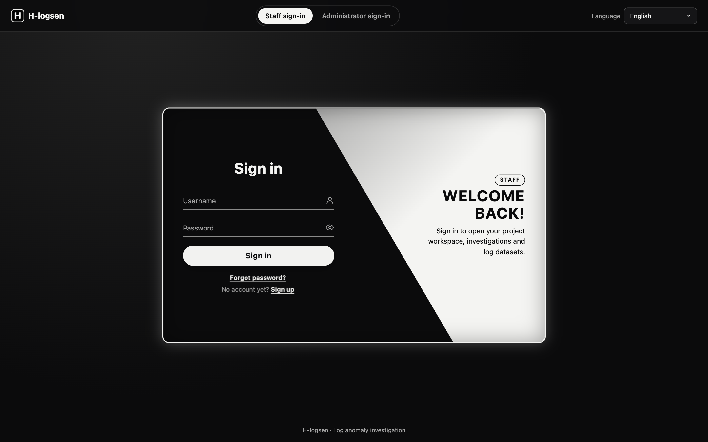
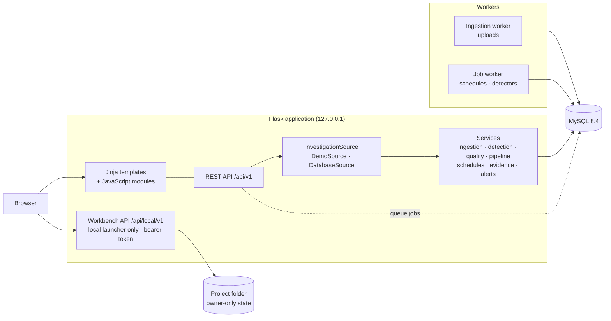
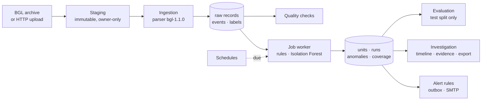

<div align="center">


# H-logsen

**A web application for log investigation, anomaly detection and data quality, with a local project workbench.**

H-logsen is a Flask application that runs in the browser. It imports large system logs into MySQL, detects
anomalies with rule-based and Isolation Forest detectors, and lets you follow every finding back to the raw
log line that caused it. On your own machine it also gives you a project workbench: follow a training run's
log, read its loss curve, edit code and use a terminal in the same window.


[Features](#features) ·
[Screenshots](#screenshots) ·
[Quick start](#quick-start) ·
[User guide](#user-guide) ·
[Architecture](#architecture) ·
[Machine learning](#machine-learning-and-evaluation) ·
[Security](#security-model) ·
[Quality](#engineering-quality) ·
[Documentation](#documentation)

</div>

<br>



---

## Contents

- [What H-logsen is](#what-h-logsen-is)
- [Features](#features)
- [Screenshots](#screenshots)
- [Quick start](#quick-start)
- [User guide](#user-guide)
  - [1. Sign in, sign up and language](#1-sign-in-sign-up-and-language)
  - [2. Find your way around](#2-find-your-way-around)
  - [3. Overview](#3-overview)
  - [4. Log Explorer](#4-log-explorer)
  - [5. Anomaly investigation](#5-anomaly-investigation)
  - [6. Alerts](#6-alerts)
  - [7. Data quality](#7-data-quality)
  - [8. Pipeline & jobs](#8-pipeline--jobs)
  - [9. Schedules](#9-schedules)
  - [10. Datasets, uploads and the Loghub catalog](#10-datasets-uploads-and-the-loghub-catalog)
  - [11. Administration](#11-administration)
  - [12. Project and Code workbench](#12-project-and-code-workbench)
  - [13. Settings](#13-settings)
  - [14. A ten-minute demonstration](#14-a-ten-minute-demonstration)
  - [15. Troubleshooting](#15-troubleshooting)
- [Other ways to run](#other-ways-to-run)
- [Architecture](#architecture)
- [Machine learning and evaluation](#machine-learning-and-evaluation)
- [Security model](#security-model)
- [Engineering quality](#engineering-quality)
- [Repository layout](#repository-layout)
- [Documentation](#documentation)
- [Status and limitations](#status-and-limitations)

## What H-logsen is

H-logsen has two parts that share one codebase, one interface and one design language:

| | Investigation platform | Project workbench |
| --- | --- | --- |
| **Purpose** | Investigate anomalies in large system logs (Loghub BGL) with evidence and provenance | Work on a project while it runs: logs, training metrics, code and a shell in one window |
| **Where in the app** | **Analysis** (chart icon) | **Project** (folder icon) and **Code** (`</>` icon) |
| **Data** | MySQL 8.4: raw lines, parsed events, detection units, runs, anomalies, coverage, alerts, schedules | Files in a project folder you choose on your own machine |
| **Who can use it** | Every signed-in account, limited to the datasets it was granted | Only on the machine that runs the server, started with the local launcher |

A few principles shape every module:

- **Evidence before conclusions.** Every anomaly links back to the exact raw bytes, line number and source
  file it came from, the detector version and configuration that produced it, and the coverage that proves
  the interval was actually analysed. Missing coverage is never shown as "no anomalies".
- **Honest evaluation.** Detectors never read labels. Splits are chronological and disjoint; thresholds are
  chosen on validation data and frozen before the test period. Reported metrics come with their cohort.
- **Bounded by design.** Every query, page, upload, cursor, preview and parser input has an explicit limit,
  so the interface stays responsive on millions of events and cannot be turned against the server.
- **Local and private.** The server listens on `127.0.0.1` only. File and terminal access needs a token
  created at launch. Credentials, uploads and model files are stored owner-only.

## Features

The **Analysis** area has a menu on the left with four groups.

| Group | Page | What it does |
| --- | --- | --- |
| Monitoring | **Overview** | Key numbers (events, hosts, severe events, anomalies, open alerts, quality score), a *Needs attention* list that links each item to the page that explains it, hourly log volume of the last 48 hours of data and the data flow |
| | **Log Explorer** | Search syntax (`host:R02* level:ERROR -service:KERNEL "phrase"`), facets that filter or exclude on click, log volume by level with click-to-zoom, log patterns, insights (error spikes, new patterns, detector anomalies), surrounding logs on the same host, saved views, live refresh and a scoped CSV export |
| | **Anomaly investigation** | Anomaly timeline per detector with zoom and range selection, filters by entity, priority and detector, paginated results and an evidence drawer with the raw log, parsed fields, detector evidence and related anomalies |
| | **Alerts** | Alert rules per dataset, alerts with cooldown, status changes (open, acknowledged, investigating, resolved), assignment and an audit trail; e-mail through an outbox |
| Data operations | **Data quality** | A quality score from five checks (malformed lines, duplicates, missing fields, time gaps, volume drop), each shown with its observed value and expectation, and an hourly coverage grid |
| | **Pipeline & jobs** | The path from raw logs to alerts, coloured by the latest state of each stage, a grid of the last 20 runs per job type, job details, retry and run again |
| | **Schedules** | Recurring jobs: run a detector or import the next lines of the BGL archive every 15 minutes, hour, 6 hours or day; pause, resume, run now, edit, delete |
| Data sources | **Datasets** | Register, rename and delete datasets you can access; upload BGL log files |
| | **Loghub catalog** | The Loghub collection read live from the Zenodo REST API, compared with the archives already downloaded |
| Administration | **User management** | Administrators only: approve or reject sign-ups, create, edit and delete accounts, grant dataset access |

Around it:

| Area | What it does |
| --- | --- |
| **Accounts** | Every page is behind sign-in. Two portals: staff and administrator. Sign-up waits for approval; sign-up, approval, welcome and one-time password-reset e-mails are sent with Flask-Mail |
| **Ingestion** | Streaming, versioned BGL parser; atomic batches that commit rows, counters and checkpoint together; safe resume after a crash; immutable staging for uploads |
| **Detection** | Host-window rule and Isolation Forest detectors with chronological train / validation / test splits; frozen, checksum-verified model bundles for inference |
| **Project workbench** | File explorer, live log tailing with level timelines, loss-by-epoch charts, run history and comparison, machine load, data-file profiling (CSV, JSONL, Parquet), split code editor with Ruff and Pyright, terminals, SSH, PDF preview |
| **Interface** | 15 languages, eight colour palettes, keyboard navigation, reduced-motion support, smooth page transitions |

## Screenshots

All screenshots show the current build with the demo data (the first 60,000 lines of Loghub BGL).

| Overview | Log Explorer |
| --- | --- |
|  |  |
| Key numbers, what needs attention, hourly volume and the data flow. | Search, insights, volume by level, facets and one-line log rows. |
| **Anomaly investigation** | **Evidence** |
|  |  |
| One scope drives the timeline, filters and results. | Every finding opens its raw line, fields, detector evidence and related anomalies. |
| **Data quality** | **Pipeline & jobs** |
|  |  |
| Five checks with observed values and expectations; empty hours in red. | One square per run; select one to see its details and run it again. |
| **Schedules** | **Sign-in** |
|  |  |
| Recurring detector runs and imports, run by the worker. | Staff and administrator portals, sign-up and password reset. |
| **Project workspace** | **Code** |
|  |  |
| Follow `train.log` while it is written; the loss chart reads `metrics.csv`. | Split editor with Ruff and Pyright diagnostics, run and track a file. |

## Quick start

The quickest way to see everything working is the demonstration command. It needs Docker, because it
starts MySQL 8.4 in a container.

### 1. Requirements

| | |
| --- | --- |
| Python | 3.10 – 3.14 (3.12 recommended) on Windows, macOS or Linux |
| Docker | Docker Desktop (or Docker Engine on Linux), running |
| Data | `data/raw/BGL.zip` from Loghub (about 57 MB, not stored in Git) |
| Browser | A current Chrome, Edge, Firefox or Safari |

### 2. Install once

```bash
git clone https://github.com/HieuHoai2704/H-LogSense.git
cd H-LogSense
python3 -m venv .venv
source .venv/bin/activate                 # Windows: .venv\Scripts\activate
python -m pip install -e ".[dev,qa]"
```

Download the BGL archive from Zenodo (record 8196385) and check it:

```bash
curl -L -o data/raw/BGL.zip https://zenodo.org/api/records/8196385/files/BGL.zip/content
```

```bash
md5sum data/raw/BGL.zip                   # macOS: md5 data/raw/BGL.zip
```

The checksum must be `4452953c470f2d95fcb32d5f6e733f7a`.

### 3. Start the demonstration

Start Docker, activate the environment and run:

```bash
python -m scripts.run.demo
```

Keep this terminal open while you use the app. The first run takes one to two minutes: it starts MySQL 8.4
in a container on `127.0.0.1:3308`, creates the tables, creates two accounts, imports the first 60,000 lines
of BGL, runs the rule and Isolation Forest detectors and opens the app in your browser. Later runs only
start the container and the app. Every run also starts the **job worker** in the background (its log is in
`.local/demo/worker.log`), so reruns and schedules complete on their own.

### 4. Sign in

The passwords are generated on your machine and kept owner-only in `.local/demo/accounts.txt`. Print them
with:

```bash
python -m scripts.run.demo accounts
```

| Portal | Account | Can use |
| --- | --- | --- |
| **Staff sign-in** | `staff` | The whole application |
| **Administrator sign-in** | `admin` | The whole application and **User management** |

### 5. Stop

Press `Ctrl+C` in the terminal that runs the app, then stop MySQL. The data is kept for next time.

```bash
python -m scripts.run.demo stop
```

A step-by-step walkthrough in Vietnamese, including the check loop, is in
[docs/development/RUN_DEMO_VI.md](docs/development/RUN_DEMO_VI.md).

## User guide

This guide follows the app from sign-in to every page. The examples use the demo data; with your own data
the steps are the same.

### 1. Sign in, sign up and language

1. Open the app. The sign-in page has two tabs at the top: **Staff sign-in** and **Administrator sign-in**.
   Use the tab that matches the account; an administrator account cannot sign in through the staff tab and
   the other way round.
2. Enter the username and password and choose **Sign in**. The eye icon shows the password while you type.
3. To change the interface language, use **Language** at the top right of the sign-in page. Inside the app
   the language is under **Settings → Language**. Fifteen languages are available, including English and
   Vietnamese.
4. **No account yet?** Choose **Sign up**, enter a username, an e-mail address and a password of at least
   8 characters. The account waits until an administrator approves it; you receive an e-mail at each step.
5. **Forgot password?** Enter your e-mail address. You receive a one-time link that works for one hour.
6. To sign out, choose **Sign out** at the top right. This ends the session in every open tab of the app.

Without an SMTP server, e-mails are written as `.eml` files to `~/.h-logsen/outbox`. To send real e-mail,
set `SMTP_ENABLED=1` and the `SMTP_*` settings described in the [operations guide](docs/OPERATIONS.md).

### 2. Find your way around

The bar at the top has four icons, and a fifth for administrators:

| Icon | View | Use it for |
| --- | --- | --- |
| Chart | **Analysis** | Every page of the investigation platform, through the menu on the left |
| Folder | **Project** | A project folder on this machine: its log, loss chart, runs and a terminal |
| `</>` | **Code** | The code editor, terminal, problems, output, ports and debug console |
| Gear | **Settings** | Appearance, language, remote machines, Python and packages, data, extensions |
| People | **User management** | Administrators only: sign-up requests, accounts and dataset access |

In **Analysis**, the menu on the left has the groups **Monitoring**, **Data operations**, **Data sources**
and, for administrators, **Administration**. Each report page has a dataset selector at the top right;
the menu keeps the selected dataset when you move between pages.

### 3. Overview

**Analysis → Overview** is the first page after sign-in. It answers "is everything all right?".

1. Choose the dataset at the top right if you have more than one.
2. Read the five key numbers: parsed events and hosts, severe events (ERROR, FATAL, SEVERE and above) and
   their share, anomalies and how many are high or critical, open alerts, and the quality score.
3. Work through **Needs attention**. Each line links to the page that explains it: failed jobs, quality
   checks that failed or warn, open alerts, high-priority anomalies, error spikes, new log patterns,
   failed or overdue schedules and jobs waiting for the worker. Choosing an error spike opens the Log
   Explorer on exactly that time range.
4. **Log volume** shows events per hour over the last 48 hours of data; severe events are red.
5. **Data flow** shows the state of each stage: raw logs → import → quality checks → ML detectors → alerts.

### 4. Log Explorer

**Analysis → Log Explorer** searches the parsed logs of one dataset.

**Search.** Type in the search box and press **Apply**. Terms are combined with AND:

| You type | Finds |
| --- | --- |
| `machine check` | Messages that contain both words |
| `"machine check"` | Messages that contain the exact phrase |
| `level:ERROR` | Events of that level (`level:FATAL`, `level:INFO`, …) |
| `host:R02-M1*` | Hosts that start with `R02-M1` (`*` at the end matches any suffix) |
| `service:KERNEL` or `component:KERNEL` | Events from that component |
| `-service:KERNEL`, `-timeout` | Excludes the field value or the word |

Open **Search syntax** under the box for the same reference. **More filters** sets the start and end time
(UTC, the end is exclusive) and the dataset.

**Insights** (the list above the chart) reports error spikes, log patterns that are new in the range and
anomalies found by the detectors. **Zoom in** narrows the page to a spike; **Open investigation** opens the
anomaly timeline on the same range.

**Log volume** stacks events per interval by level. Click a bar to zoom into that interval; **Reset time
range** goes back.

**Facets** count levels, hosts and components in the current scope. Click a value to filter on it,
Shift-click to exclude it.

**Logs and Patterns.** **Logs** lists one event per row, newest first. Click a row to open its raw
evidence: the raw line (secrets and e-mail addresses are redacted), the surrounding logs of the same host
whatever the filters, and its provenance. From there, **Filter by this host** and **Show this pattern**
narrow the search. **Patterns** groups messages after replacing numbers and hexadecimal values with `<*>`;
choosing a pattern searches for its events.

**Saved views.** Type a name in **View name** and choose **Save view** to keep the current search, filters
and time range. **Choose a saved view** restores it; **Delete view** removes it. Views belong to your
account.

**Live.** Tick **Live · refresh every 15 s** to follow new events as they are imported.

**Export scoped CSV** downloads exactly the rows in the current scope.

### 5. Anomaly investigation

**Analysis → Anomaly investigation** shows what the detectors found.

1. **Source** selects the dataset (or the synthetic demo source). **Time range** offers the full imported
   range or shorter windows. **Display timezone** only changes how times are shown.
2. Type in the search box or open **Entities**, **Priority** and **Detectors** to narrow the scope, then
   choose **Apply**. **Clear filters** resets them.
3. **Data coverage** tells you whether the selected interval was actually analysed. "Unknown" or missing
   coverage means "not analysed", not "no anomalies".
4. **Evaluation** shows precision, recall and F1 of the selected runs on the original test split, when
   labels exist.
5. **Anomaly activity** is a grid with one row per detector and one cell per time bin. A cell shows the
   highest priority in it (L Low, M Medium, H High, C Critical) and the count. Hover or focus a cell for
   the exact interval and breakdown. Click a cell, or use **Select range…**, **Zoom in**, **Zoom out** and
   the arrows, to move through time; **Severity** and **Volume** switch what the cells show.
6. **Results** lists the anomalies in scope, newest first. Click a row (or its arrow) to open the
   **evidence drawer**: detection time, host, detector, unit and model run, the detected signal, the raw log
   lines that support it, the detector's features and threshold, and related anomalies by host, time or
   window. **Previous anomaly** and **Next anomaly** move through the results without closing the drawer.
7. Export the results in scope as CSV from the results header.

### 6. Alerts

**Analysis → Alerts** opens the alert panel of the selected dataset.

1. **Create alert rule** (accounts with manager permission on the dataset): give it a name, a minimum
   priority (for example High), optionally a detector ID or host, and a cooldown in seconds. While the
   cooldown runs, the same rule does not raise a second alert for the same target.
2. When a detector run finishes, matching anomalies become alerts in the table. **Refresh alerts** reloads
   it.
3. Select an alert to change its status (open → acknowledged → investigating → resolved), assign it to a
   user ID and add an investigation note. Each change is recorded in the history below.
4. **Queue window rule** and **Queue Isolation Forest** queue a new detector run on the dataset;
   **Check job** shows its progress. The worker runs it.

### 7. Data quality

**Analysis → Data quality** scores the dataset from its import counters and parsed events.

| Check | Passes when |
| --- | --- |
| Malformed lines | At most 0.1% of raw lines fail to parse |
| Duplicate lines | At most 0.1% of raw lines repeat an earlier line exactly |
| Missing fields | At most 1% of events lack a host, component or level |
| Time gaps | Every hour between the first and last event has logs (gaps of up to 3 hours are a warning) |
| Volume drop | The last 6 hours keep at least 75% of the median 6-hour volume of the previous day |

Each check shows its status (passed, warning, failed or skipped), the observed value and the expectation.
The score averages the judged checks (passed 100, warning 50, failed 0). **Hourly coverage** draws one cell
per UTC hour for the last 14 days: darker means more events, red means an hour without events. The same
report is available as JSON from `GET /api/v1/quality?dataset_id=N`.

### 8. Pipeline & jobs

**Analysis → Pipeline & jobs** shows how the data moves and every job that moved it.

1. **Data flow** shows each stage with its latest figure (lines, events, score, anomalies, open alerts)
   and state.
2. **Job grid** has one row per job type (log import, rule detector, Isolation Forest, the validated and
   frozen profiles) and one square per run, oldest on the left, the last 20 runs. Green is completed, blue
   is running, grey is queued, red is failed.
3. Select a square to open **Job details**: status, rows processed, detector run, alerts created,
   configuration and, for a failed job, the error code.
4. **Run again with this configuration** queues the same job again; a failed job can be retried. The
   worker picks it up within a few seconds; refresh the page to see the new square.
5. **Recent jobs** lists the latest jobs in a table.

### 9. Schedules

**Analysis → Schedules** runs jobs on a timetable.

1. Under **Add a schedule**, enter a **Schedule name** (for example "Rules every hour"), choose the **Task**
   (Rule detector, Isolation Forest or Import the next BGL lines) and how often it **Runs** (every 15
   minutes, hour, 6 hours or day). For an import, set **Lines per import**. Leave **Enabled** ticked and
   choose **Add schedule**.
2. The table shows each schedule with its next and last run. **Run now** queues it immediately; the job
   number in **Last run** links to its details in Pipeline & jobs.
3. **Pause** and **Resume** stop and restart a schedule, **Edit** changes it, **Delete** removes it.
4. Schedules need the worker. The demo command starts it; otherwise run `python -m scripts.run.worker`.
   A worker that was stopped runs a missed schedule once, not once per missed slot. A schedule that is late
   is marked *Overdue* and listed on the Overview.

Import schedules read the archive configured by the operator (`LOGSENSE_BGL_ARCHIVE`, default
`data/raw/BGL.zip`) from the last checkpoint; a web page can never choose the file.

### 10. Datasets, uploads and the Loghub catalog

**Analysis → Datasets** lists the datasets you can access with their key, state and actions.

- **Register dataset** creates an empty dataset; **Rename** changes its name; **Delete empty dataset**
  removes one that has no data. **View logs** opens it in the Log Explorer.
- To add log data from a file, open the **Log Explorer**, then **Import BGL log data**: upload a BGL
  `.txt`/`.log` file or a CSV with one `raw_line` column, up to 16 MiB. The upload is queued and imported by
  the ingestion worker (`python -m scripts.run.ingestion_worker`); "Queued" means not yet imported.

**Analysis → Loghub catalog** reads the Loghub collection from the Zenodo REST API (it needs an internet
connection) and shows which archives are already in `data/raw`.

### 11. Administration

Sign in through **Administrator sign-in**. **Administration → User management** then appears in the menu.

1. **Review requests** shows the accounts *Waiting for approval*. **Approve** activates one and e-mails
   the user; **Reject** refuses it.
2. **Add account** creates a staff or administrator account directly.
3. **Search** by username or e-mail and filter by role and state; the list is paged. **Edit** changes the
   e-mail address, role, active state, password and **Dataset access**. A staff account only sees the
   datasets granted here.
4. **Delete account**, at the bottom of the edit page, removes an account after a confirmation. You cannot
   delete your own account.

If a demo password is lost, sign in as `admin`, edit the `staff` account and set a new password.

### 12. Project and Code workbench

The workbench reads files and opens terminals **on the machine that runs the server**, so it is available
only when H-logsen is started with the local launcher (`python -m scripts.run.demo` or
`python -m app.workbench`). Started with plain `flask run`, these views have no file or terminal access.

**Project**

1. Choose **Open folder** (or **Choose folder**) and enter the absolute path of a project. System, home,
   temporary and hidden roots are refused.
2. Select a `.log` file in the tree to follow it. **Log levels over time** groups WARN, ERROR and CRITICAL
   lines by interval; click a cell to pin its lines in the terminal. **Return to latest log** resumes.
3. If the project has a `metrics.csv` with the columns `epoch,train_loss,val_loss`, **Loss by epoch**
   draws the training curves. **Machine load** shows CPU, RAM and, with an NVIDIA GPU, GPU and VRAM.
4. Select a `.csv`, `.jsonl` or `.parquet` file to profile it: schema, sample rows, missing values,
   duplicates and distributions.
5. **Run history**, **Attach run** and **Compare two runs** follow and compare training runs.

**Code**

1. Open a file from the tree; **Split pane** opens a second editor. Save with `Ctrl+S` (`Cmd+S` on macOS).
2. **Check Python** runs Ruff and Pyright and lists the results in **Problems** with links to the line;
   **Format** formats the file; **Run file** runs it in a new terminal; **Track run** records it in the
   run history.
3. The dock below has **Terminal** (with split panes and new sessions), **Problems**, **Output**, **Ports**
   and a **Debug** console.

The full reference for these views is the [workbench guide](docs/WORKBENCH_GUIDE.md).

### 13. Settings

| Section | What you can change |
| --- | --- |
| **Appearance** | One of eight colour palettes for the whole app |
| **Language** | The interface language (15 languages) |
| **Remote machines** | SSH connections that open a remote terminal, with a pre-verified host key |
| **Python and packages** | The interpreter used to run files, and the installed packages |
| **Data** | The current project, its files and active log source, with links to the datasets and the sample log stream |
| **Extensions** | Built-in capabilities that can be turned on or off |

### 14. A ten-minute demonstration

A suggested order for presenting the project:

1. **Sign-in** as `staff`; show the language switch.
2. **Overview**: the key numbers and *Needs attention*; open an **error spike**.
3. **Log Explorer**: search `level:FATAL`, click a host facet, open a row and its surrounding logs, show
   **Patterns**, save a view.
4. **Anomaly investigation**: click a high-priority cell, open the evidence drawer, step with **Next
   anomaly**.
5. **Data quality**: the score, the *Time gaps* warning and the coverage grid.
6. **Pipeline & jobs**: select a job, **Run again with this configuration**, refresh to see the new run.
7. **Schedules**: add "Rules every 15 minutes", **Run now**, find the job in Pipeline & jobs.
8. Sign out and sign in as `admin`: **User management**, approve a sign-up, grant a dataset.
9. **Project** and **Code**: open a project folder, follow its log, show the loss chart and the terminal.

### 15. Troubleshooting

| Problem | What to do |
| --- | --- |
| `docker: command not found` on macOS | Start Docker Desktop, then `export PATH="/Applications/Docker.app/Contents/Resources/bin:$PATH"` |
| The demo says `data/raw/BGL.zip` is missing | Download it as in [Quick start](#2-install-once); without it the demo dataset is empty |
| Jobs stay **Queued** | The worker is not running. Use the demo command, or run `python -m scripts.run.worker` with the same `DATABASE_URL` |
| An upload stays **Queued** | Run the ingestion worker: `python -m scripts.run.ingestion_worker` |
| A schedule is **Overdue** | Same as above: the worker is not running |
| Forgot the demo passwords | `python -m scripts.run.demo accounts` |
| Project or Code says the local workbench is unavailable | Start the app with `python -m scripts.run.demo` or `python -m app.workbench`, not `flask run` |
| The browser did not open | Run the same command again: while the server runs, it only reopens the browser |
| Loghub catalog shows an error | The catalog needs an internet connection to Zenodo |

## Other ways to run

**The workbench without Docker.** Start the local server and open the browser. Without a database, the
investigation pages use a synthetic demo source.

```bash
python -m app.workbench                   # add --no-browser to print the private URL instead
```

**The web application alone** (no file or terminal access):

```bash
python -m flask --app app run --host 127.0.0.1
```

**Your own MySQL server.** On Windows and macOS the repository can manage a private MySQL runtime bound to
`127.0.0.1`; on Linux, point `DATABASE_URL` at any MySQL 8.4 server.

```bash
python -m scripts.run.mysql_runtime start
python -m scripts.run.mysql_runtime exec --role migrate -- -m flask --app app db upgrade
python -m scripts.run.mysql_runtime exec --role app -- -m scripts.run.database register-bgl --key bgl-research-v1
python -m scripts.run.mysql_runtime exec --role app -- -m scripts.run.database ingest-bgl --dataset ID --archive data/raw/BGL.zip --limit 100000
python -m scripts.run.mysql_runtime exec --role app -- -m scripts.run.database create-user --username admin --role admin --dataset ID
python -m scripts.run.mysql_runtime exec --role app -- -m scripts.run.worker
python -m scripts.run.mysql_runtime exec --role app -- -m scripts.run.workbench
```

The runtime generates private credentials and passes them to child processes without printing them;
account creation prompts for the password. Uploads, alerts, SMTP and the workers are covered in the
[operations guide](docs/OPERATIONS.md).

## Architecture

H-logsen is a modular monolith: one Flask application with clearly separated layers, used in the browser.
Long-running work never happens inside an HTTP request; it is queued in MySQL and run by workers.



| Layer | Location | Responsibility |
| --- | --- | --- |
| Presentation | `app/templates`, `app/static` | Server-rendered pages and JavaScript modules; one stylesheet system (`ui.css`); no build step |
| HTTP | `app/api`, `app/web_*.py` | Thin routes, Flask-WTF forms, validation at the boundary, translated errors |
| Source interface | `app/api/sources.py` | One protocol, two backends; routes never branch on the data source |
| Domain services | `app/services` | Ingestion, detection, quality, pipeline, schedules, evidence, alerts; independent of HTTP |
| Contracts | `app/contracts.py` | Typed shapes shared across layers: investigation scope, job configuration, identities |
| Persistence | `app/models.py`, `app/domain.py`, `migrations/` | SQLAlchemy 2 models and Alembic migrations; composite foreign keys scope every row to its dataset |
| Workbench | `app/workbench` | Files, terminals, runs, previews; OS code isolated in `app/workbench/platforms` |
| Workers | `scripts/run` | Shared supervision loop with database back-off and recovery of interrupted jobs |

### Data pipeline



- **Ingestion** reads bounded physical lines, keeps the exact source bytes and their offsets, and commits
  each batch together with its checkpoint. Re-running the same file resumes; a changed file is rejected.
  Each event records the parser version that produced it, and a dataset never mixes versions.
- **Detection** runs over a snapshot (`input_revision`, highest event id). If the dataset changes while a
  detector runs, nothing is published. Window models cache their features under a digest that is part of
  the run configuration, so a retried job scores exactly the same input.
- **Isolation by dataset** is enforced in SQL: child tables carry `(dataset_id, id)` composite foreign keys,
  so a row cannot reference an event, unit or run of another dataset even through a bug in application code.

### Key design decisions

| Decision | Reason |
| --- | --- |
| Modular monolith instead of services | One deployable for a local tool; boundaries are enforced by modules, typed contracts and tests |
| Server-rendered UI with plain JavaScript | No build pipeline to maintain; pages load fast and work in every current browser |
| Keyset pagination with signed cursors | Stable pages under concurrent imports; cursors cannot be forged or reused across scopes |
| Content Security Policy with per-response nonces | The workbench API can reach the file system, so injected script must not run |
| Frozen model bundles verified by SHA-256 | Inference must never refit or recalibrate on the data it scores |
| Jobs and schedules in the database, run by a worker | Requests stay fast; a crashed job is recovered and a missed schedule runs once |
| Outbox for e-mail | Delivery happens outside the transaction; a crash between send and record is detectable |

## Machine learning and evaluation

The detectors are baselines with deliberately strict evaluation rather than tuned showcase numbers.
Loghub labels are used only to evaluate the test period; labels supplied with an upload are reported
separately and marked unverified.

| Model | Unit | Test cohort | Precision | Recall | F1 | Average precision | FPR |
| --- | --- | --- | ---: | ---: | ---: | ---: | ---: |
| Isolation Forest, July holdout (preregistered) | Host window, 5 min | 172,529 observed windows | 22.52% | 55.43% | 0.3203 | 0.2656 | 0.2037% |
| Isolation Forest V2 (frozen study) | Host window | 89,119 later windows | | 38.60% | 0.4202 | 0.1845 | |
| Host-window IF, default policy (historical) | Host window | 100K-line prefix | | 0% | | | |

- These are **different cohorts** and must not be read as a progression on one test set.
- The July model misses 82 positive windows and raises 351 false positives on its test. Its frozen
  inference profile only scores closed windows after its calibration cutoff and never retrains.
- Features are label-blind: event count, severity share, template diversity and dominance per host window,
  with templates derived by replacing numeric and hexadecimal tokens.

Details: [July holdout and model contract](docs/ml/IF_JULY_HOLDOUT.md) ·
[Isolation Forest audit](docs/ml/ISOLATION_FOREST_AUDIT.md) ·
[detector semantics](docs/database/DETECTORS.md).

## Security model

| Concern | Control |
| --- | --- |
| Local API exposure | Loopback only; a random bearer token per launch; Host and Origin checks on every request |
| Script injection | Content Security Policy with per-response nonces; autoescaped templates; secrets, tokens and e-mail addresses redacted from displayed logs |
| Authentication | Every page behind sign-in (default deny), password hashing, session reset at sign-in, rate-limited login, CSRF protection on every state change, one-time signed reset links that expire after an hour, a new session secret each time the server starts |
| Authorization | Two account types (staff, admin) plus explicit per-dataset grants, enforced in queries and by composite keys; only administrators manage accounts |
| File system | Project root sandbox (system, home, temporary and hidden roots refused); credential files never served; Windows 8.3 aliases and reserved device names refused |
| Data at rest | Owner-only files and folders, verified after creation; a strict mode for filesystems that ignore POSIX modes |
| Uploads | Size, encoding and control-character checks; immutable staging; no download route for originals |
| Database | Least-privilege accounts; `DELETE` granted only on the tables whose pages offer it |

Please report vulnerabilities privately as described in [SECURITY.md](SECURITY.md).

## Engineering quality

| Practice | Implementation |
| --- | --- |
| Tests | About 290 unit and API tests without a database; about 150 integration tests against MySQL 8.4; browser end-to-end tests in Chromium |
| Compatibility | Test suite verified on Python 3.10, 3.12, 3.13 and 3.14; type-checked for Linux and Windows (the terminal backends differ) |
| Static analysis | ruff (lint and format) and mypy with strictly typed core modules, enforced in CI and pre-commit |
| Refactoring safety | Large refactors are verified with equivalence harnesses: tens of thousands of generated inputs fingerprinted before and after, on fixtures and on a real MySQL pipeline |
| Internationalization | 15 languages; whole-message catalogs with placeholders checked against the source; CLDR plural forms; a test rejects concatenated fragments |
| Continuous integration | Lint and types, unit tests, research tests, MySQL integration and browser end-to-end tests |

```bash
ruff check . && ruff format --check . && mypy --platform linux && mypy --platform win32
python -B -m unittest discover -s tests                     # unit and API tests
python -m scripts.qa.verify_mysql                           # MySQL integration (MYSQL_ADMIN_URL, DATABASE_URL)
python -m scripts.qa.qa_workbench_browser                   # browser end-to-end tests (Playwright)
```

## Repository layout

```text
app/                 the product
├── api/             REST routes and the investigation source interface
├── services/        ingestion, detection, quality, pipeline, schedules, evidence, alerts
├── parsers/         streaming BGL and HDFS parsers
├── workbench/       local files, terminals, runs, previews
│   └── platforms/   terminal backends: ConPTY on Windows, POSIX elsewhere
├── templates/       Jinja pages and partials
├── static/          JavaScript modules, styles, vendored libraries
└── locales/         interface catalogs (English is the source, 14 translations)
migrations/          Alembic schema history (MySQL 8.4)
scripts/             run · qa · ml · bench commands
tests/               unit, API, browser and MySQL integration tests
docs/                guides, architecture, database, ML and release notes
academic/            research notes and experiments (not shipped)
```

A file-by-file map is in [docs/development/CODE_STRUCTURE_VI.md](docs/development/CODE_STRUCTURE_VI.md).

## Documentation

| Topic | Documents |
| --- | --- |
| Using the app | [User guide](#user-guide) (above) · [Workbench guide](docs/WORKBENCH_GUIDE.md) · [Run the demo step by step (Vietnamese)](docs/development/RUN_DEMO_VI.md) |
| Operating the platform | [Operations guide](docs/OPERATIONS.md) · [MySQL runbook](docs/database/MYSQL_RUNBOOK.md) |
| API | [REST API reference](docs/database/API.md) |
| Data model | [Schema](docs/database/SCHEMA.md) · [ERD](docs/database/ERD.md) · [BGL pipeline](docs/database/BGL_PIPELINE.md) · [Uploads](docs/database/UPLOADS.md) |
| Machine learning | [Detectors](docs/database/DETECTORS.md) · [July holdout](docs/ml/IF_JULY_HOLDOUT.md) · [Isolation Forest audit](docs/ml/ISOLATION_FOREST_AUDIT.md) |
| Architecture | [Architecture notes](docs/architecture/README.md) · [Code structure](docs/development/CODE_STRUCTURE_VI.md) |
| Testing | [Testing guide](docs/database/TESTING.md) |
| Contributing | [Reviewing](REVIEWING.md) · [Contributing](CONTRIBUTING.md) · [Security](SECURITY.md) |

## Status and limitations

H-logsen is at version **0.4.13** and is developed as a preview.

- External SMTP delivery, production deployment behind TLS, screen-reader certification and detection over
  the complete BGL archive are outside the verified scope.
- Uploads accept BGL-compatible text and single-column `raw_line` CSV; the platform is not a generic log importer.
- The project workbench works only on the machine that runs the server; other machines use the
  investigation platform through the browser.
- The private July model bundle is not part of the repository; a clone reports that profile as unavailable.

Planned work is tracked in the [backlog](docs/releases/BACKLOG.md).

## Contributing and review

Reviews are welcome. [REVIEWING.md](REVIEWING.md) is a guided tour for reviewers: what to read first, how
to verify each claim in this README, and checklists for security, data correctness, ML evaluation and the
interface. [CONTRIBUTING.md](CONTRIBUTING.md) covers the development setup and the standards a change must meet.

## License

Copyright © 2026 Truong Hieu Hoai. All rights reserved.

The source is shared for review and evaluation. No license to use, copy, modify or distribute it is granted
unless the author agrees in writing. Third-party components keep their own licenses; see
[THIRD_PARTY_NOTICES.md](THIRD_PARTY_NOTICES.md) and `app/static/vendor/`.

## Acknowledgements

The BGL and HDFS datasets come from [Loghub](https://github.com/logpai/loghub)
(Zhu et al., *Loghub: A Large Collection of System Log Datasets for AI-driven Log Analytics*, ISSRE 2023);
see [data/raw/LOGHUB_LICENSE.txt](data/raw/LOGHUB_LICENSE.txt). The interface vendors xterm.js,
highlight.js, Lucide icons and Moment.js.
