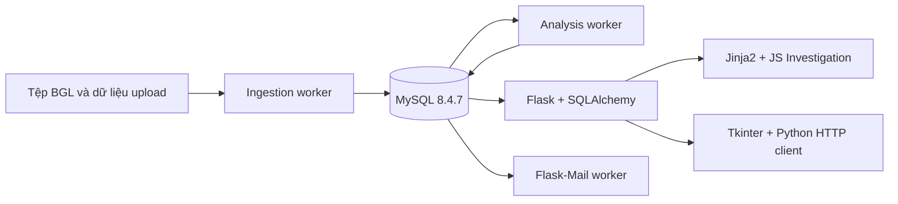

# Báo cáo đồ án Python nâng cao
## LogSense AI — Hệ thống điều tra bất thường trong nhật ký

### 1. Bài toán và phạm vi

Kỹ sư vận hành cần biết thời điểm xảy ra bất thường, máy nào liên quan và bản ghi nào hỗ trợ nhận định. LogSense AI nhận log BGL, chuẩn hóa có lưu nguồn gốc, phát hiện các cửa sổ máy chủ bất thường và đưa bằng chứng vào một workspace điều tra. Bản University MVP hướng đến luồng chạy được trên máy cục bộ với dữ liệu thực. Phạm vi đã đo, kết quả kiểm thử và các bước còn thiếu được ghi trong [báo cáo QA](../../docs/releases/UNIVERSITY_MVP_READINESS_VI.md).

### 2. Kiến trúc

Flask dùng app factory, cấu hình theo môi trường và Blueprint để tách route xác thực, dữ liệu, xử lý job, điều tra và cảnh báo. Jinja2 dựng trang đầu, JavaScript gọi API cho thao tác tương tác. Trang quản lý dataset còn minh họa Jinja inheritance, Flask-WTF, flash và POST/Redirect/GET. Desktop Tkinter dùng cùng API và session, giảm trùng logic phân quyền. Worker chạy ngoài request Flask để tác vụ dài có thể báo tiến độ và phục hồi. Tham chiếu [factory](../../app/__init__.py), [desktop](../../scripts/run/desktop.py), [ingestion worker](../../scripts/run/ingestion_worker.py).

### 3. Dữ liệu và ERD

| Nhóm | Quan hệ chính | Ý nghĩa |
|---|---|---|
| Ingestion | data_sources → datasets → source_artifacts → raw_log_records → log_events | Giữ tệp nguồn, checksum, vị trí byte/dòng và sự kiện đã phân tích. |
| Detection | detectors → detector_versions → detector_runs và detection_units ↔ log_events qua unit_events | Cố định thuật toán, cấu hình và tập bản ghi làm bằng chứng. |
| Kết quả | detector_runs → detection_predictions / anomaly_outputs / evaluation_reports | Tách mọi dự đoán khỏi các dự đoán bị gắn cờ và báo cáo đánh giá. |
| Access | users ↔ datasets qua user_datasets | Vai trò cấp khả năng thao tác, grant theo dataset giới hạn dữ liệu cụ thể. |
| Incident | alert_rules / anomaly_outputs → alerts → alert_audit / notification_outbox | Liên kết cảnh báo với chứng cứ và lưu lịch sử xử lý. |

Có 23 bảng nghiệp vụ ở Alembic head `0004`. Các FK ghép theo dataset ngăn tham chiếu chéo dữ liệu. Trang log dùng chỉ mục dataset/timestamp/id để phân trang theo cursor. SQLAlchemy quản lý giao dịch và migration được kiểm thử trên MySQL 8.4.7. [ERD đầy đủ](../../docs/database/ERD.md) · [Truy vấn và chỉ mục](../../docs/database/QUERY_AND_INDEX_STRATEGY.md).

### 4. Ingestion BGL

Parser duyệt dữ liệu theo dòng, giữ raw bytes, thời gian Unix UTC, dấu thời gian gốc, Node, message, nhãn và provenance. Dòng lỗi được ghi trạng thái để kiểm tra. Batch ghi dữ liệu và cập nhật checkpoint trong cùng transaction, nên ngắt trước commit giữ checkpoint cuối đã xác nhận. Import lặp dùng cùng định danh nguồn/dòng và không nhân đôi. Upload qua Flask-WTF giới hạn kích thước, kiểm định định dạng và checksum rồi tạo job cho worker. CSV hỗ trợ một cột raw_line với provenance dòng vật lý. Nhãn upload được đánh dấu do người dùng cung cấp. [Parser](../../app/parsers/bgl.py) · [Ingestion](../../app/services/bgl_ingestion.py) · [Upload](../../docs/database/UPLOADS.md).

### 5. Phát hiện bất thường và đánh giá

Đơn vị phát hiện dùng trong thí nghiệm là cửa sổ UTC 300 giây theo host có log đã parse. Một cửa sổ có nhãn dương nếu chứa ít nhất một sự kiện dương theo cách ánh xạ của nghiên cứu. Rule-based dùng thống kê đếm và ngưỡng đã cấu hình. Isolation Forest dùng đặc trưng đếm/tần suất/mẫu/cửa sổ được tính từ log. Train, validation, test tách theo thời gian. Nhãn giữ ngoài vector đặc trưng, được dùng trên validation để chọn ngưỡng và trên test để đánh giá. Điểm native IF càng thấp càng bất thường. Bảng AP dùng sklearn average precision.

| July holdout, 172.529 host-window, 184 dương | Precision | Recall | F1 | AP | FPR |
|---|---:|---:|---:|---:|---:|
| Rule đếm cũ | 0,002361 | 0,038043 | 0,004446 | 0,029312 | 0,017163 |
| IF cũ | 0,001812 | 1,000000 | 0,003618 | 0,025977 | 0,588053 |
| IF chọn trên validation | 0,225166 | 0,554348 | 0,320251 | 0,265610 | 0,002037 |

IF đã chọn có 102 TP, 351 FP, 82 FN và 171.994 TN. Kết quả thuộc nghiên cứu July với các mốc 01/07 → 14/07 → 21/07 → 28/07 UTC năm 2005. Lần trình diễn 100K prefix June dùng bộ detector mặc định và có mục đích kiểm tra luồng vận hành. Việc nạp profile đã hiệu chỉnh đòi hỏi bundle tin cậy và cửa sổ sau mốc cutoff tương ứng. [Nghiên cứu holdout](../../docs/ml/IF_JULY_HOLDOUT.md) · [Detector](../../docs/database/DETECTORS.md).

### 6. REST API và trải nghiệm điều tra

| Luồng | Endpoint tiêu biểu | Hành vi |
|---|---|---|
| Truy cập | POST /api/v1/auth/login, GET /api/v1/auth/me | Session và token CSRF cho thao tác thay đổi dữ liệu. |
| Dữ liệu | /api/v1/datasets, /api/v1/logs | CRUD metadata có RBAC, query theo khoảng UTC, host, severity, tìm kiếm và cursor. |
| Phát hiện | POST /api/v1/detection/jobs | Lập job có idempotency key. Worker tính và lưu kết quả. |
| Điều tra | /api/v1/anomalies/timeline, /api/v1/investigation | Tổng hợp server-side, cùng phạm vi với bảng kết quả. |
| Bằng chứng và xuất | /api/v1/anomalies/{id}/evidence, /api/v1/anomalies/export | Phiên bản detector, ngưỡng, raw log đã che dữ liệu nhạy cảm và CSV đúng phạm vi. |
| Alert | /api/v1/alert-rules, /api/v1/alerts | Quy tắc, acknowledgement, trạng thái, người xử lý, ghi chú và audit. |

Log Explorer phân trang server-side. Investigation có Severity/Volume, brush/zoom, bộ lọc, Evidence Drawer và Demo Mode tách riêng. Timeline dùng khoảng UTC `[start,end)` và đếm theo output detector. Một unit có thể có nhiều detector output. Ngữ cảnh điều tra hiển thị observed/reference khi có dữ liệu. CSV xuất theo scope và xử lý giá trị có nguy cơ bị bảng tính diễn giải thành công thức. Điểm và bằng chứng được dùng để ưu tiên kiểm tra. Cột nguyên nhân giữ trống khi chưa xác minh. [Minh chứng E2E](../../docs/releases/E2E_REAL_BGL.md).

### 7. Kiểm thử và hiệu năng

Tái kiểm thử Windows ở thư mục `14)LogSense_AI` ghi nhận 157 PASS và 113 SKIP trong discovery mặc định. Bộ MySQL tách riêng chạy 125/125 PASS, gồm test SQL được bảo vệ và một số guard chạy trùng. Browser trên BGL 100K qua 12/12 nhóm, DEMO workspace 21/21 và drawer 13/13. Bản cài sạch với venv và MySQL datadir riêng kiểm chứng manager chưa có grant tạo dataset đầu tiên, upload 100.000 dòng với 0 malformed, 158.218 dự đoán, 158 kết quả bất thường và CSV khớp. Sau restart MySQL sạch, các count và migration head giữ nguyên.

| Đo lịch sử trên BGL thật | 10K | 100K | 1M |
|---|---:|---:|---:|
| Import một lần, giây | 1,932 | 25,078 | 294,710 |
| Tốc độ importer, dòng/giây | 5.175,2 | 3.987,5 | 3.393,2 |
| Peak RSS importer, MiB | 68,64 | 69,42 | 70,88 |
| GET /api/v1/logs p50/p95, ms | 9,13 / 27,89 | 25,94 / 42,31 | 189,79 / 846,59 |

Mốc 1M thuộc ingest và truy vấn parsed logs, chạy trên Windows/MySQL cục bộ. Số RAM chỉ đo tiến trình importer. Lượt hiện tại đo warm HTTP 12 lần mỗi endpoint trên 100K, ví dụ Timeline anomaly p50 31,41 ms và p95 35,16 ms. [Benchmark gốc và EXPLAIN](../../docs/database/IMPLEMENTATION_REPORT.md) · [QA sau đổi thư mục](../../docs/releases/V1_RC1_RETEST.md).

### 8. Giới hạn và kết luận

Các bước học phần đã có bằng chứng kỹ thuật được đối chiếu trong [ma trận môn học](COURSE_REQUIREMENTS_MATRIX_VI.md). Hồ sơ nộp bảy bài mạng đúng đề, Workbench GUI và rubric giảng viên còn cần chốt. SMTP ngoài hệ thống và macOS chưa chạy trong đợt này. Bản cài sạch trên Windows đã qua kiểm thử. Bản source release cuối và một buổi diễn tập do người trình bày thực hiện vẫn cần chốt. Các hướng mở rộng như rollup, đa tenant và benchmark nhiều người dùng nằm trong backlog. Kết quả hiện tại cho phép trình diễn luồng BGL thực từ ingest đến điều tra có chứng cứ, với các giới hạn đã ghi.

