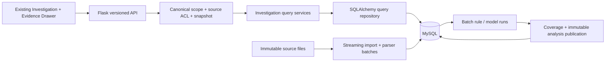

# Investigation V3 — large-scale architecture proposal

Status: **PROPOSED, NOT IMPLEMENTED**. Audit date: 2026-11-03, Asia/Ho_Chi_Minh.
Scope: architecture, reproducible benchmark methodology and measured V2 baseline.
No database migration, application refactor, new service or infrastructure is authorized here.

Companion documents:

- [Data model, query and index strategy](V3_DATA_AND_QUERIES.md)
- [Timeline V3 API and aggregation contract](V3_TIMELINE_API.md)
- [Benchmark methodology and results](../benchmarks/v3/REPORT.md)

## 1. Current architecture assessment

| Area | Source evidence | Conclusion |
|---|---|---|
| Stack | `requirements.txt`: Flask and tzdata; `config.py`: demo access flags | Flask/Jinja2 modular application; MySQL/SQLAlchemy remains a target, not a current implementation |
| Persistence/schema/indexes | No model, extension, migration or SQL connection modules | No deployed schema or index inventory to inspect; no EXPLAIN result can honestly be reported |
| Input | `app/services/investigation.py:iter_records()` adapts six `ANOMALIES` | All current views are synthetic; no parsed/raw/detection-unit storage |
| Aggregation | `build()` calls `records()`, filters a scope list, sorts results, constructs bins, scans facets | Server-side Python aggregation, not SQL-side aggregation; backend work/memory is not bounded by response paging |
| Endpoint paths | Timeline, result list and composite routes all call `build()` | A timeline request also builds results/facets; a list request also builds timeline bins |
| Detector catalog | Four hardcoded logical slugs and two display groups | Stable slugs within demo; no persisted catalog, version registry or analysis-run selection |
| Results/export | Full sort before page slicing; export materializes sorted matches before CSV streaming | A 50-row response and streamed CSV do not imply bounded database/Python work |
| Evidence | Source policy; separate raw and related APIs; bounded heap and signed cursor | Good response bounds, but selected-record lookup, related search and navigation still scan the fixture iterator |
| Raw/feature preview | Full text/dict is redacted/serialized before truncation | Bounded response, not bounded work for an arbitrarily large stored record |
| Coverage | Static fixture ranges and four synthetic lifecycle source modes | No import watermark, missing-interval ledger or model-analysis coverage |
| Snapshot | Static revision; evidence cursor key generated at app creation | No real input/analysis snapshot; cursor keys would differ across separately created worker apps |
| Frontend | Jinja fragments, finite HTML cells, mode switch, brush/zoom, AbortController and sequence guards | Existing Investigation UX is reusable; no React/Vue rewrite is needed |
| Payload | Composite returns escaped HTML plus timeline/facet/event JSON | Duplicate representations and per-cell links can grow independently of raw log count |
| Import | `scripts/download_research.py` downloads/checksums archives | Acquisition is not streaming import, parsing, DB inserts or anomaly detection |
| Tests | Existing fixture correctness, API, security-policy and browser reports | Useful regressions; not SQL, DB-size, concurrent load or million-event evidence |
| Working tree | `git status` reports no Git repository | No uncommitted status available; application/data files remain unchanged by this architecture task |

### Environment feasibility check

Windows exposes about 31.7 GiB RAM and about 409.9 GiB free on D: at audit time
(free RAM varies; see benchmark environment artifact). No MySQL client/server
command, MySQL/MariaDB service/process or listener on 3306/33060 was detected.
Docker CLI exists, but its Linux-engine named pipe is unavailable: the daemon is
not running. SQLAlchemy and PyMySQL are not installed in this environment.

This establishes an unavailable local benchmark target, not proof that no remote
MySQL server exists. No connection details or approved isolated remote target were
supplied. No Docker daemon was started and no DB/packages were installed for V3.
The isolated 10K/100K/1M MySQL benchmark is therefore **NOT EXECUTED**.

## 2. Counting model

Never use one `event_count` field for all layers.

| Metric | Definition | Example of why it differs |
|---|---|---|
| `raw_line_count` R | Physical lines read from a source artifact, under declared blank/multiline policy | Malformed lines still count; multiple lines may form one record |
| `parsed_event_count` P | Successfully emitted canonical event records for a parser version | A line may emit zero, one or several events |
| `detection_unit_count` U | Distinct logical units under an explicit unit definition: event, window, session/block | One session contains many events; window units may overlap |
| `evaluated_unit_count` E | Run/unit evaluations; counts are per run and are not necessarily stored as E rows | Four detectors can evaluate the same U units |
| `anomaly_output_count` A | Unique flagged output keys in the selected published analysis snapshot | Several detectors may flag the same underlying occurrence |
| `displayed_aggregate_count` C | Count of rendered aggregate cells, not anomalies | `(1 + visible detector rows) * bins`; cell count values sum to A only under the specified partition |

Keep `incident_count` undefined until there is an explicit correlation/deduplication
model. Different detector outputs are not automatically one incident.

**Illustrative planning example, not measured data:** P=1,000,000 event units,
D=4 detectors evaluating every event, U=1,000,000 and E=4,000,000. If 0.1% of
evaluations flag an anomaly, A=4,000; at 10%, A=400,000. Neither case is one
million anomalies. Event/window/session mixes need separate U and E denominators.

For file sizing, R*mean(raw UTF-8 bytes per line) estimates logical source bytes
only. At R=1M and 200 bytes/line this is 200 MB decimal; it is NOT the MySQL
physical size. Measure table/index/undo/redo/temp/backup storage independently.
Do not assume compression ratios. Persist raw/parsed/unit/output counters with
definitions, parser/run IDs and quarantine counts; unavailable values remain null.

## 3. Proposed modular architecture

Keep one Flask codebase and one MySQL database initially. Separate ingestion,
parsing, detection, publication, query and presentation modules. CLI batch jobs
can implement MVP background work; do not introduce a broker by default.

Proposed repository operations: `aggregate_overall`, `rank_detectors`,
`aggregate_detector_page`, `page_anomalies`, `facet_counts`, `get_evidence`,
`page_related_events`, `stream_export` and `coverage_for_scope`. They share an
immutable validated `InvestigationScope` and access/snapshot predicates; they do
not call an all-purpose builder that loads and computes every view.

Use SQLAlchemy Core/select projections for analytics; ORM entities are appropriate
for small metadata operations. Do not call `.all()` on event/anomaly datasets.
For export, configure and verify driver-level streaming, bounded `yield_per`,
connection lifetime and transaction cleanup. API row limits alone do not prove
driver buffering is bounded. See [SQLAlchemy streaming documentation](https://docs.sqlalchemy.org/en/20/core/connections.html#using-server-side-cursors-a-k-a-stream-results).

## 4. Timeline and detector grouping

- Preserve current Overall → detector groups → results → evidence flow.
- Ranges: 15m/1h/6h/24h/7d/30d and explicit custom UTC boundaries. Live presets
  anchor to an explicit server as-of instant; historical sources anchor to a dated
  sample/source end and say so. Switching timezone does not move UTC boundaries.
- Auto resolution uses drawable plot width, meaningful source precision and query
  cost. Prefer readable cells (>=24px), normally 30–80 bins where the span/width
  permits; hard cap 120 including partial edge bins. Short ranges may have fewer
  than 30 bins. Coarsen rather than silently sample/drop anomalies.
- Overall covers every matched detector, independently of row paging/collapse.
  Twelve detector rows by default, eight on compact layouts, at most twenty.
- Compute detector ranking from one grouped SQL summary, then fetch only the
  chosen rows' bins. Avoid allocating every detector-by-bin matrix before paging.
- Groups: Rules, Statistical, Classical ML, Sequence models, Unknown. Family comes
  from persisted metadata, not a frontend guess. Do not relabel the existing
  unimplemented Event novelty example as a known model family.
- Stable logical detector identity is separate from detector version/run IDs.
  Default snapshot chooses one published logical result set per detector/unit;
  multiple versions require an explicit comparison view, not implicit mixing.
- Sort by unique output count, maximum ordinal priority or latest anchor timestamp,
  tie-break by stable detector ID. Group/collapse state only controls presentation.
- Severity = maximum observed ordinal priority, with text/symbol; Volume = unique
  output count on a separate count scale, never native detector scores.
- Zoom/brush keep filter semantics. Zoom requeries SQL for fresh bins. Exact-range
  form and keyboard remain available. Future Canvas is conditional on measured
  DOM cost, with the existing accessible inspector retained.

API semantics and payload shape are specified separately in `V3_TIMELINE_API.md`.

## 5. Filter, snapshot and evidence consistency

`InvestigationScope` contains tenant/source authorization, dataset ID,
input revision, analysis snapshot/run selection, UTC range, hosts, services,
detectors, priorities, literal search and optional timeline selection.

AND across categories, OR within category. Timeline aggregates use the global
scope. Results/CSV and drawer Previous/Next add the timeline selection. Facets
exclude their own dimension and selection; all other global dimensions apply.
Every count reports its scope. A multi-entity unit matches if its entity membership
matches each dimension; requiring host/service on the SAME constituent event is
a different explicit mode, not an accidental join behavior.

The drawer's default context deliberately differs from result membership: it
uses the same authorized dataset/input revision and a labelled relationship/time
window, and may go outside the global anomaly filters. Make this choice explicit
in `context_scope`; offer a results-only mode if needed. Do not claim existing
related-context queries equal the main table filter. This is documented behavior.

Publish immutable input batches and detector outputs. An analysis snapshot maps
logical detectors to explicit published run sets, with one owner per logical
unit/signal key. Retries must not duplicate output rows. Reanalysis versions do
not replace historical evidence silently.

For MVP, enforce one published run per logical detector in each snapshot. Later
incremental/sharded run sets require disjoint unit ownership or an explicit
snapshot output-ownership constraint; unique run/unit keys alone cannot prevent
two selected runs from double-counting the same logical detector/unit result.
An explicit model-run filter must belong to the authorized selected snapshot.

Within one read transaction, resolve/verify the input revision and analysis
snapshot, then run all query components against them. Separate HTTP requests
send the same revision/snapshot token. If the client revision is no longer served,
return 409 and refresh coherently; never join a fresh timeline to an old table.
Do not hold a transaction open for the lifetime of a browser tab. A long export
needs an explicit pinned snapshot/retention lease or a short, bounded streaming
transaction. Publish new import/detection batches atomically; partial commits
must not appear complete.

Use one configured signing key shared by Flask workers, with key versioning and
rotation policy, rather than `secrets.token_hex()` per `create_app()`. Cursor
signatures bind tenant/access-policy version, input/analysis revisions, canonical
scope, ordering and last exact timestamp+ID. Recheck access on every request.

## 6. Bottleneck report: measured versus inferred

Measured values are only in `../benchmarks/v3/REPORT.md` and its raw JSON. Current
fixture API/DOM measurements cannot establish large-data SQL capacity.

| Bottleneck / risk | Evidence type | V3 response |
|---|---|---|
| Full materialization, sort before LIMIT, repeated facets | Direct source observation | Push WHERE/GROUP BY/order/keyset into SQL; narrow projections |
| Timeline and table endpoints do unrelated work | Direct source observation | Separate repository query paths and DTOs |
| All-detector matrices allocated before row page | Direct source observation | Rank detector summaries first, aggregate selected page only |
| Composite HTML+JSON and repeated per-cell URLs/labels | Source observation; payload baseline measured | Shared bin axis, compact data contract; don't repeat full filter URLs in every cell |
| Related heap bounds retained rows but scans source | Direct source observation | Indexed dataset/entity/time keyset SQL queries |
| Preview limits applied after full redaction/serialization | Direct source observation | Bound stored-record size at import; secure chunk/redaction strategy before raw-store integration |
| Per-worker signing secret | Direct source observation | Shared configured key; rotating key version in token |
| Text substring search can scan all scoped rows | Design risk, not measured SQL failure | Explicit literal-search policy and time bounds; benchmark before changing search semantics |
| MySQL temp tables, bad index choices, IO saturation | Unverified | EXPLAIN ANALYZE and isolated measurements required, not guessed |

Do not fix production code in this architecture task. These become implementation
tasks only after review/approval.

## 7. Scaling roadmap and cost/complexity

| Level | Architecture | Cost drivers | Gate / deferred work |
|---|---|---|---|
| A — University MVP | One Flask app + MySQL; streaming CLI import, batch rules/models; baseline indexes; immutable published runs | One DB and app process; event/anomaly storage, batch CPU, basic backup | Pass 10K then 100K correctness/performance; keep existing UX |
| B — Portfolio | Same modules; separate job process, bounded work queue if necessary; tuned queries and retention | Worker RAM/CPU; retry/checkpoint storage; monitoring; test/benchmark automation | Execute isolated 1M matrix; add summaries/cache ONLY for measured repeated bottlenecks |
| C — Enterprise pilot | Load-tested worker/web capacity; per-tenant isolation, retention, restore drills, audit/metrics and failure recovery | Availability, backup copies, operational support, security and concurrency | Separate approval and measured need; not implemented now |

No price quote or dollar estimate is asserted without a chosen host, workload and
retention. Estimate capacity from measured row/index bytes and R/P/U/E/A rates:
`retained_days * daily_bytes + indexes + temp/import headroom + backup copies`.
CPU cost follows evaluated units/features, not only anomaly count. Concurrent
query memory follows workers * per-query buffer budget, not just dataset size.

Parquet is a later reproducible batch/ML/archive artifact, not an automatic
replacement for MySQL interactive queries. Summary tables add coverage/revision
maintenance; cache adds authorization-safe invalidation; partitions add retention
and index constraints. Kafka/Elasticsearch/ClickHouse/Kubernetes are not proposed
as default dependencies.

## 8. Approval and completion boundary

This deliverable stops at architecture and benchmark reporting. No application
schema/API migration or infrastructure change is made. Next implementation gate:
approve the domain/count semantics and API; then provision an isolated MySQL
benchmark target, validate schema/index choices on 10K and 100K, and only then
attempt 1M under the documented guardrails. V3 scalability is not achieved merely
because a six-record API happens to be fast.
