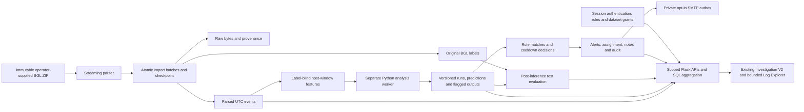

# Implemented architecture

The application remains a modular Flask monolith. No React/Vue rewrite, second
backend, OS service, Redis or message broker was introduced.

`app/extensions.py` owns shared SQLAlchemy/Migrate instances. The factory imports
metadata, optionally initializes the MySQL engine, and registers Blueprints.
No startup DDL or automatic database fallback exists. SQLAlchemy sessions are
request-scoped; batch services use explicit Session/transaction contexts.

`models.py` contains the log/detector foundation; `domain.py` contains identity,
prediction/evaluation and incidents. Composite dataset FKs prevent cross-dataset
references in the database. Services implement concrete workflows; templates do
not issue SQL or decide authorization.

The public demo provider remains bounded and explicitly synthetic. The MySQL
adapter uses SQL COUNT/GROUP BY, bounded result/facet/detector pages and immutable
run selection. Raw supporting logs load only on demand. The browser cancels stale
requests and preserves investigation filters when drawers close.

V3 is still broader than the implementation: immutable multi-run publication
manifests, tenant identity federation, retention enforcement, summary/columnar
storage, distributed scheduling and real-time ingestion are not claimed. Current
log snapshots pin an append-only event ID watermark; anomaly snapshots pin one
completed run per logical detector. Unknown source-time completeness is explicit.
