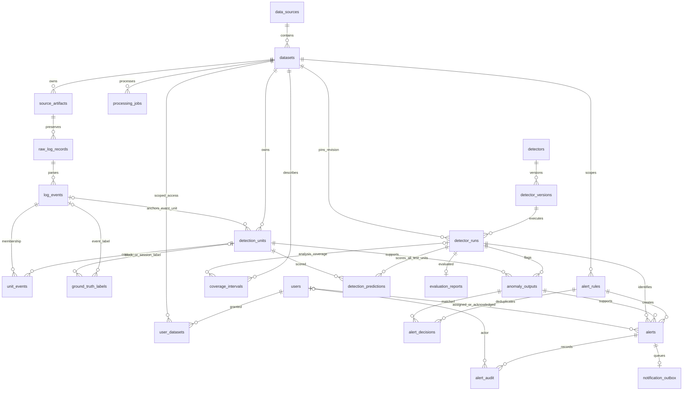

# Database ERD

Every scoped child has `dataset_id`; composite foreign keys enforce ownership,
not merely a service-layer convention. An output cannot reference a unit or run
in a different dataset. A run's `(detector_id, version_id)` must reference the same
logical detector. Labels target **exactly one** event or unit. Raw/event mappings
permit multiple parser outputs using `emit_index`; current BGL emits zero or one.

There are 23 domain tables at head 0004. An authenticated account can have zero dataset grants. A manager-created dataset and its creator grant are committed together. Local identity, assignment, audit and outbox are implemented. Full V3 analysis publication manifests, rollups, tenant federation and retention policies remain deferred.
